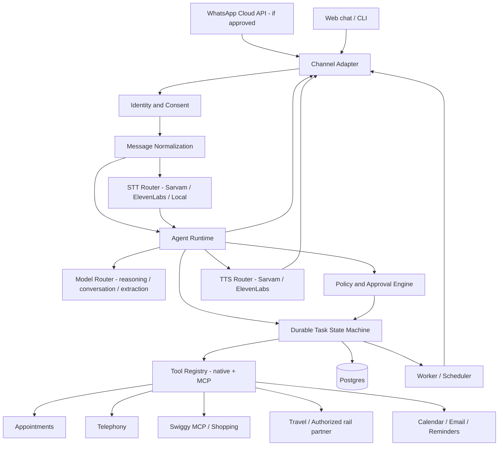

# Project Saathi — Product Requirements Document (PRD)

> **Codex project initiation specification**
> **Version:** 1.0 · **Status:** Ready for technical discovery and implementation planning
> **Prepared:** 27 October 2026 · **Primary market:** India
> **Product:** Saathi — a voice-first, multilingual personal action agent for Indian families
> **Primary intended channel:** WhatsApp, **subject to Meta platform eligibility and written/authoritative policy validation**
> **Other supported entry points:** local development console, lightweight web chat, optional other approved messaging channels
> **Original input:** *Project Saathi — A personal AI agent for Indian families on WhatsApp* (uploaded concept document)

---

## 0. Read this first: product decisions and launch blockers

**Product promise:** *Speak naturally. Get things done.* A user can describe an errand in Tamil, Malayalam, Hindi, English, or a mixture; Saathi understands it, plans a sequence of operations, uses authorized tools, asks permission before consequential actions, and reports an actual verified result. It must never describe an intent, simulated response, or unverified website state as a completed booking, order, payment, or call.

**Architectural decisions:**

1. **Hermes is NOT required for WhatsApp.** WhatsApp Cloud API supports direct webhook/media/message integration. Hermes is an optional orchestration/gateway implementation, not a platform dependency. Build Saathi's business logic behind provider-neutral abstractions so it can run with or without Hermes.
2. **LLMs and speech services are hot-swappable by role.** Configure a planner/reasoner independently from a conversational/generation model, STT independently from TTS, and choose providers such as Sarvam AI, ElevenLabs, OpenRouter, hosted/open-weight models, and local engines as supported. Provider-specific differences must be hidden behind adapters.
3. **"Do any task" means an extensible, permissioned action platform, not magical access to every business.** The agent may perform *any supported task for which a lawful/authorized tool or integration exists*. New skills must be addable without rewriting the conversation engine. If a tool is missing or access is blocked, clearly offer a safe handoff rather than pretending completion.
4. **WhatsApp is a high-risk launch dependency for this product in India.** Meta's WhatsApp Business Solution terms restrict providers/developers from distributing general-purpose AI assistants when AI is the primary functionality; exceptions noted in the published text apply to European Economic Area/Brazil numbers, **not generally to Indian numbers**. A broad personal AI agent such as Saathi plausibly falls within the restriction. **Do not assume Cloud API production approval.** Obtain current policy/commercial review and, if necessary, Meta approval *before public WhatsApp launch*. A business-specific support bot allowance is not blanket authorization for Saathi. This is a launch gate, not a software bug. [META-TERMS]
5. **Use WhatsApp Cloud API only where permitted.** Do not use Baileys/unofficial WhatsApp Web automation to evade platform restrictions. Hermes' Baileys connector may be suitable for isolated personal testing subject to applicable terms, but it is **not the production path**.
6. **Financial transactions and purchase commitments require explicit user authorization.** Prefer provider-hosted checkout, authorized delegated payment schemes where available, or user-completed UPI intents. No unattended PIN/OTP collection, hidden purchases, or uncapped spending.
7. **Ship vertical slices.** First deliver an end-to-end appointment workflow with voice, confirmation, verified booking, and reminder; then add calls, groceries, commerce, and travel without changing the core contracts.

### 0.1 Architecture recommendation

**Recommended:** A standalone Saathi service that speaks the official WhatsApp Cloud API directly through a `ChannelAdapter`, and implements its own durable task orchestration and provider-neutral tool registry. Optional `HermesAdapter` can be evaluated later for orchestration, browser actions, or rapid internal demos. This gives Saathi explicit control over consumer auth, cross-task approval, budgets, localization, persistence, model selection, and compliance.

**Rationale:** Hermes has WhatsApp Cloud API and personal WhatsApp integrations, agent tools, and model switching, but Saathi's family identity, commerce approval semantics, India-specific vendor integrations, and reminder/template compliance should remain first-class app logic. Hermes also currently documents limitations around template-based re-engagement in its Cloud API adapter; Saathi cannot rely on an unverified Hermes reminder capability for production notifications. [HERMES-CLOUD] [HERMES-MODELS]

### 0.2 Non-negotiable go/no-go gates

| Gate | Required decision/evidence | If not met |
|---|---|---|
| G1: WhatsApp policy | Written/authoritative confirmation the proposed consumer-facing Saathi offering is permitted for Indian users, on the chosen route | Use web chat/other allowed channel; preserve WhatsApp adapter but disable public onboarding |
| G2: WhatsApp technical | Valid Meta app/WABA, test number, signed inbound webhook, permitted templates, media access | Work in local/recorded webhook simulation |
| G3: Action authorization | Provider credentials, permissioned OAuth, business agreements, lawful API or approved partner | Mock/read-only mode or guided user handoff |
| G4: Commerce | Authenticated checkout, price/address recap, user approval, provider receipt/order ID | Do not place order or charge user |
| G5: Calls | Approved telephony account, recipient/consent and applicable India telecom compliance, call disclosure, call outcome protocol | Mock call transcript only; clearly marked simulation |
| G6: Travel | Authorized ticketing partner/API where required (not IRCTC scraping or CAPTCHA bypass) | Search/status only, then official user handoff |

---

## 1. Product context

### 1.1 Problem

Indian families routinely coordinate repairs, appointments, groceries, payments, transportation, school routines, and reminders across fragmented websites, apps, calls, and messaging threads. Language and navigation friction are high. Existing chat assistants often answer questions but do not finish tasks.

### 1.2 Solution

Saathi is a **personal AI action layer** available through natural voice notes and text. It translates goals into observable plans, completes steps through integrated services (APIs, MCP servers, calendars, telephony, authorized browser-based flows), and explains results in the user's language. WhatsApp is the preferred UX *where contractually permitted*, not the exclusive identity or execution system.

### 1.3 Product principles

- **Outcome over chat:** Success means an appointment ID, ticket/PNR from an authorized partner, provider order ID, logged phone-call outcome, created reminder, or an explicitly disclosed unsuccessful/handoff state.
- **Users control consequential actions:** Clarify ambiguity and confirm exact merchant, person, date, location, quantity, cost, payment method, and material conditions before commitment.
- **Voice and mixed-language are first-class:** Tamil, Hindi, English in first release; Malayalam is targeted next. Users can code-switch mid-sentence.
- **Tools are capabilities, not entitlements:** No credential means no execution. Permission failures are visible.
- **Composable and modular:** Separate user/channel, models, speech, planning, approval, task execution, and provider integrations.
- **Family privacy:** Personal and household data use scoped permissions and sensible retention.
- **Honest status:** Never conflate `planned`, `requested`, `submitted`, and `confirmed`.

### 1.4 Users and personas

| Persona | Situation | Success example |
|---|---|---|
| Busy parent | Coordinates school schedules, service appointments, groceries | “Remind us every Sunday to check the kids' school bag and order milk.” |
| Elder family member | Prefers mother-tongue voice interactions | Sends a Tamil note asking to call appliance support; receives Tamil recap |
| Working professional | Needs delegated errands while busy | “Find a dental appointment for Saturday morning and book the 10:30 slot.” |
| Household organizer | Coordinates recurring tasks across relatives | “Add father's doctor appointment to our shared calendar.” |

**Primary launch persona:** One consenting adult user acting for their own errands. **Household sharing:** staged feature; do not infer all family members are authorized merely because they use the same WhatsApp group.

---

## 2. Outcomes and success measures

### 2.1 Goals

1. Execute multi-step tasks, beginning with booking and extending to calls, groceries, commerce, travel, and household planning.
2. Support voice-note-to-action in Indian languages, including code-switching.
3. Make swapping the planner, conversational model, STT, and TTS a configuration change rather than a rewrite.
4. Provide a WhatsApp-first experience when eligible; preserve product functionality through a fallback channel when not.
5. Enforce permission, confirmation, idempotency, recoverability, and auditability.

### 2.2 Proposed acceptance targets (product targets, not researched benchmarks)

| Metric | Pilot target | Measurement |
|---|---:|---|
| End-to-end simulated appointment completion | >= 95% over fixed happy-path test set | Completed task with mock booking ID |
| Live integrated appointment completion | >= 80% where a partner offers bookable slots | Provider-confirmed booking / eligible attempts |
| Unapproved external commitments | **0** | Purchase/booking/call without stored approval |
| False claims of completion | **0** in release-gate scenarios | Manual + automated trace review |
| Successful provider hot swap | **100%** across supported test provider pairs | Contract/e2e tests without core business-code change |
| Tool retry duplicate commits | **0** in tested scenarios | Duplicate provider orders or appointments |
| Hindi/Tamil/English voice task understanding | >= 85% on representative pilot utterances | Correct structured intent/entities |
| User-visible acknowledgement | <= 5 s p95 in test setup | Accepted message to “working on it”/status |
| Manual recovery from an interrupted task | Supported for every mutating workflow | Resume/retry/cancel test suite |

Targets should be revisited after baseline measurements; speed varies by phone provider, model, and integration.

### 2.3 Non-goals for first release

- Diagnoses, treatment recommendations, or clinical medical advice. Appointment help is administrative only.
- Open-ended autonomous spending, collecting/storing UPI PINs, handling OTPs by proxy, or bypassing user verification.
- Guaranteeing access to every airline/train/merchant; access depends on authorized integrations.
- Unrestricted shell execution, web scraping behind access restrictions, CAPTCHA circumvention, or breaking third-party ToS.
- Unsupervised outreach to arbitrary strangers or large-scale telemarketing.
- General family-group access to all personal data without individual consent.

---

## 3. Release scope and capability roadmap

**Legend:** P0 = initial engineering foundation/demo; P1 = first functional beta; P2 = expanded beta; P3 = partner-dependent/future.

| Capability | Priority | Minimum genuine outcome | External dependency / gating |
|---|---|---|---|
| WhatsApp text + voice notes | P0, conditional | Receive and respond via official API in approved test scope | Meta legal/policy gate, WABA, webhook |
| Local web chat / CLI | P0 | Same core task engine independent of WhatsApp | None |
| Multilingual STT: Tamil/Hindi/English | P0 | Transcript + confidence/alternatives + language detection | Sarvam and/or ElevenLabs APIs |
| Malayalam & code-switching hardening | P1 | Tested bilingual/region speech conversations | Model-specific coverage evaluation |
| Independent inference/reasoning/voice provider selectors | **P0** | Switch without business-logic changes | Provider API credentials |
| Goal decomposition + multi-step execution | **P0** | Auditable task graph and tool observation loop | Internal task engine |
| Appointment search + booking + confirmation | **P0** | Real booking reference for supported provider, mock in CI | Partner tools or compliant booking site |
| WhatsApp/text reminder + calendar | P0/P1 | Scheduled reminder and delivery record | Approved Meta template after 24h; calendar OAuth |
| Calling a business (repair/support/booking) | **P1** | Call placed, summarized, with outcome/transcript where permitted | Exotel/telephony account, call compliance |
| Swiggy Instamart grocery buying | **P1** | Search → cart → preview → approved order → order ID | Swiggy MCP OAuth/production access |
| Shopping / other merchandise | P2 | Catalog → comparison → cart → approved checkout/order | Merchant/partner APIs or hosted checkout |
| Restaurant bookings/food delivery | P2 | Reservation/order confirmation | Swiggy Dineout/Food MCP or other approved partner |
| Fare comparison, tracking, alerts | P2 | Valid fare/status source, threshold alert | Approved travel API, notification templates |
| Train tickets / IRCTC | **P3 (partner-gated)** | Authenticated paid ticket/PNR only via authorized PSP/partner | IRCTC-approved service provider pathway |
| Event tickets | P2 | Confirmed event reservation/ticket | Swiggy Scenes/approved partner |
| UPI/other India payment execution | **P3 (regulated/partner-gated)** | Approved, verified payment reference | PSP, NPCI-compliant scheme, hosted approval |
| Kids routine planner | P1 | Recurring checklist + opted-in reminders | Calendar/reminder scheduler |
| Email integration | P1 | Draft/send approved message; read with scopes | Gmail/Microsoft Graph OAuth |
| Family roles, shared plans | P2 | Explicit shared grants/revocations | Family identity and permissions |
| Arbitrary new MCP skill | **P0 (framework)** | Register, schema-validate, authorize, invoke, trace | Each skill's provider access |

**Scope clarification:** The first shippable slice must showcase genuinely completed action, not necessarily all categories at once. The architecture must make all categories implementable. Every listed category must have at least a capability contract and deterministic mock fixture before beta.

---

## 4. Core user journeys

### J1 — Voice note → dental appointment → confirmation → reminder (hero flow)

1. User (Tamil/Hindi/English) sends: “Book my dental cleaning Saturday morning.”
2. Channel retrieves audio by authenticated media ID; speech adapter transcribes, detects language, preserves original utterance.
3. Agent extracts `service=dental cleaning`, a **resolved date** in user's timezone (`Asia/Kolkata`), preferred window, location, user identity, optional provider/budget.
4. Agent requests only missing critical facts (e.g., city, preferred clinic if necessary), searches live authorized availability, and provides 2–3 ranked choices with actual date/time/location/quoted costs when available.
5. User chooses a slot; Saathi displays a clear final review and asks **Book / Change / Cancel**.
6. On explicit `Book`, execute exactly once; verify partner's confirmed booking ID and store it.
7. Respond in the user's selected language and schedule a reminder, using compliant templates if the WhatsApp 24-hour window is closed.
8. On stale slot, invalid date, unavailable tool, user edits, or timeout, recover safely without inventing a confirmation.

**Edge cases:** “this Saturday” across midnight, vague “morning”, provider price changes, dentist vs cleaning specialist, different booking name, multiple users on a household account, no provider data, duplicate WhatsApp delivery.

### J2 — “Call the AC repair centre and raise a complaint”

1. Clarify product/service details and identify a verifiable recipient contact from an authorized source/user-supplied number.
2. Show call preview: purpose, number/business, permitted facts to share, and whether call may be recorded.
3. Obtain approval to call; do not impersonate a human. At call start identify as an AI assistant acting with user's permission.
4. Use `TelephonyProvider` (e.g., Exotel) to call and conduct a constrained conversational workflow; handle hold/IVR, transfer, interruption, language, and contact refusal within technical/legal limits.
5. Store call outcome (connected/not answered), ticket/reference if given, transcript/summary only with legally appropriate notices and retention, and recommended next step.
6. If call cannot be completed, surface status and optionally prepare a message/handoff.

### J3 — “Buy milk and eggs for tomorrow morning”

1. Identify household address and authorization for the grocery provider.
2. Search products through official Swiggy Instamart MCP (if access approved), normalize brand, unit size, quantity, available substitutions, and delivery promise.
3. Show cart including merchant, item variants, exact quantities, total including fees/taxes, delivery address and payment method.
4. Ask user to approve **that exact cart and amount/approved ceiling**.
5. Place one order; store provider order ID and live status; never claim successful payment if the provider has not confirmed it.
6. On unavailable item/price change/out-of-stock, return to review; no unapproved substitution or amount increase.

### J4 — “Book a train ticket to Chennai next Friday”

1. Extract origin, destination, date, passenger/count, preferences, budget; search timetable/fare only through an authorized integration.
2. Provide options and explain that seat availability is volatile.
3. If Saathi has an IRCTC-authorized partner and an approved end-to-end booking route, use it with the passenger's explicit approval and any provider-mandated authentication/checkout.
4. If the integration is not available, create a **handoff** to the legitimate booking flow and mark status `requires_user_action`, not `booked`.
5. Only mark `completed` after a valid provider-confirmed PNR/ticket.

### J5 — “Make my daughter's weekday routine and remind us”

1. Gather routine items and timezone, proposed schedule and target audience.
2. Request consent from the recipient where necessary; handle minor data conservatively.
3. Create recurring tasks and notifications using authorized channel templates when outside a session window.
4. Enable per-item pause/change/stop, family role management, and a daily/weekly summary.

### J6 — “Compare fares and notify me when they drop”

1. Confirm route/date/threshold and comparison source.
2. Track through an approved API on a scheduled cadence with rate limits.
3. Notify only when consent and destination channel rules allow; show observed price/source/timestamp.
4. Never guarantee a fare or booking until a ticket is issued.

---

## 5. Functional requirements

### 5.1 Messaging and identity

- **FR-001** Accept normalized inbound text, voice notes, and interactive replies from official WhatsApp Cloud API in approved mode, plus a built-in web/CLI adapter.
- **FR-002** Verify inbound webhook signatures, prevent replay, and deduplicate by platform message ID.
- **FR-003** Maintain a conversation tied to a **Saathi user ID** and channel identity, not solely a WhatsApp number. Support explicit login/linking when sensitive actions need stronger identity verification.
- **FR-004** Preserve context across turns and durable tasks. Remember user-provided locale, language, timezone, addresses, and preferences with consent; do not assume cross-family permission.
- **FR-005** Handle WhatsApp's 24-hour customer-service messaging window; send approved utility templates for allowed out-of-window reminders. Fall back to an opted-in, permitted channel when templates unavailable.
- **FR-006** Provide clear `help`, `status`, `cancel`, `stop reminders`, `forget task`, and `disconnect provider` intents across supported languages.

### 5.2 Voice and language

- **FR-007** Process WhatsApp `ogg/opus` voice notes, transcode as required, limit size/duration, and keep source audio secured for short configurable retention.
- **FR-008** Support at least two STT adapters: Sarvam and ElevenLabs. Include a local/test transcription adapter; allow swap with config.
- **FR-009** Support at least two TTS adapters: Sarvam and ElevenLabs; support `text_only`, `voice_only`, and `text_and_voice` response policies. Responding with voice is optional to the user.
- **FR-010** Detect/preserve Tamil, Hindi, English and mixed-language content. Malayalam supported when selected provider/model passes validation; provide a text-first fallback.
- **FR-011** Capture transcript and confidence/uncertainty where exposed. Ask confirmation for high-risk entities (names, money, dates, ticket stations) even if model confidence appears high.

### 5.3 Agent intelligence and planning

- **FR-012** Maintain independent configurable `reasoning_model`, `conversation_model`, `extraction_model` (optional), `stt_model`, and `tts_model`, each with provider/model ID, timeout, retries, budget, and fallback order.
- **FR-013** Require typed structured plans: `goal`, steps, prerequisites, tool names, risk levels, approval points, expected outputs, timeouts and rollback/compensation strategies.
- **FR-014** Run an observe–plan–act loop with bounded iterations, step timeouts, rate limits, global budgets, and explicit terminal states.
- **FR-015** Ask minimal clarifying questions; don't silently fill material fields such as exact dates, delivery addresses, phone recipients, or maximum spend.
- **FR-016** Permit safe read-only parallelism (e.g., search several providers); serialize external side effects and use idempotency keys.
- **FR-017** Provide a policy checker outside the LLM. LLM output alone can never authorize a tool call or grant the agent additional permissions.
- **FR-018** Distinguish `unavailable`, `retryable`, `requires_auth`, `requires_user_action`, `permanently_failed`, and `completed` outcomes.

### 5.4 Capability/skill marketplace

- **FR-019** Register native tools and remote MCP tools with metadata: schema, title, permissions, risk level, data categories, provider, auth type, pricing/fees (if any), preview function, execute function, idempotency support, test mode.
- **FR-020** Require an allowlisted capability and per-user authorization before the agent can invoke real tools. A tool's presence in an MCP catalog does not imply user consent.
- **FR-021** Use strict JSON-schema/Pydantic validation for arguments and returns. Treat tool outputs, merchant descriptions, browser pages, and speech transcripts as untrusted data (prompt-injection boundary).
- **FR-022** Provide typed adapters for appointment booking, telephony, Swiggy Instamart MCP, shopping, calendar, email, reminders, travel/fare, and authorized train booking.
- **FR-023** Gracefully degrade: missing provider -> read-only suggestion or handoff. Never represent a mock success as an actual transaction.

### 5.5 Approvals, orders, and payments

- **FR-024** Classify actions as `READ`, `DRAFT`, `OUTREACH`, `BOOK`, `ORDER`, `PAY`, `DELETE`, or `SHARE`; require explicit approval for outreach to real parties and all mutating/financial actions unless a narrowly defined user-granted policy permits otherwise.
- **FR-025** Confirmation is a server-generated transaction object with canonical details, expiry, one-time token, channel identity, and exact tool arguments; changes after approval invalidate it.
- **FR-026** Accept `approve`, `reject`, or `edit`, including approved WhatsApp interactive button reply when supported. Reject stale or replayed approvals.
- **FR-027** Use a `prepare -> review -> authorize -> commit -> verify` pattern for booking/ordering. Where provider has no atomic prepare/commit, do not reexecute after ambiguous timeouts until status is reconciled.
- **FR-028** Never request/store payment PIN, bank passwords or OTPs; use hosted payment flows, provider-consented checkout, and compliant delegated UPI schemes where available. Enforce merchant/amount limits.
- **FR-029** Store receipts, order IDs, ticket IDs and cancellation/refund terms with the task, with access controls.

### 5.6 Calls, reminders, travel, families

- **FR-030** Telephony flow supports call preview, user authorization, provider initiation, voice transcript events where permitted, AI disclosure, call outcome, and failure recovery.
- **FR-031** Reminder engine supports one-off/recurring schedules, per-user timezone, cancellation, quiet hours, destination-specific notification compliance, retry tracking.
- **FR-032** Travel fare/availability results include source and retrieval time. Train purchase remains blocked until authorized ticketing integration exists.
- **FR-033** Role-based family sharing grants a specific task/calendar/address to specific users. Never auto-expose private messages, payment info or health appointments to the group.
- **FR-034** Provide explicit export and deletion of supported account/task data; obey legal retention obligations and provider contracts.

---

## 6. WhatsApp feasibility and Hermes decision

### 6.1 Is WhatsApp technically feasible without Hermes?

**Yes.** Saathi can connect directly to the official WhatsApp Business Cloud API:

1. Create an eligible Meta app, WhatsApp Business Account (WABA), and dedicated number.
2. Subscribe an HTTPS webhook to inbound messages; verify challenge and `X-Hub-Signature-256` (or official current signature scheme).
3. Download inbound audio using Meta's authenticated media endpoints; pass to STT.
4. Process the normalized event in Saathi.
5. Send a free-form text/media/interactive reply within the applicable service window. For scheduled notifications beyond that window, use an approved message template and valid opt-in.
6. Persist delivery/failed status events, user consent and opt-outs.

**But technical feasibility is not commercial permission.** The published WhatsApp Business Solution terms (as surfaced in October 2026) restrict third-party general-purpose AI assistants when AI is the primary offering; exceptions cite EEA/Brazil registration. An India-first personal action assistant is **at substantial policy risk** under that wording. Production eligibility must be independently confirmed; do not assume that using a business account or embedding tools eliminates the restriction. [META-TERMS] [META-POLICY]

### 6.2 What Hermes adds

Hermes Agent is an **optional agent runtime** developed by Nous Research. It documents WhatsApp Cloud API messaging, voice note transcription/TTS, interactive approval/clarification controls, Baileys bridging, and swappable main/auxiliary models. Its Cloud API adapter presently documents a **24-hour re-engagement limitation and no implemented template-send support**; verify latest release before considering it for Saathi reminders. Its model-switching tools do not automatically guarantee that all custom Sarvam and ElevenLabs STT/TTS variants fit Saathi's desired independent provider contract. [HERMES-CLOUD] [HERMES-MODELS]

| Approach | Upside | Downside | Decision |
|---|---|---|---|
| **A. Direct Cloud API + Saathi orchestration** | Full control of identity, action approvals, scheduler, adapters, compliance | Build and maintain task engine and channel integration | **Recommended production/reference architecture** |
| B. Hermes as entire agent + WhatsApp gateway | Faster experiment, built-in tools and gateway, model selection | Framework-specific data/state/approval logic, templates and India tools may need custom code | Optional time-boxed technical spike |
| C. Hermes as replaceable runtime behind `AgentRuntime` | Can leverage select skills while retaining Saathi domain | Added integration layer, two sets of state/tool policies | Evaluate only if A's build cost justifies |
| D. Unofficial WhatsApp Web/Baileys production bot | Easier personal linking | Fragile, unsupported, possible account limits, not a compliance workaround | **Do not ship** |

**Acceptance for Hermes spike (optional):** In two working days, prove (a) voice note receipt, (b) Sarvam STT, (c) switch reasoning model without changing tools, (d) ElevenLabs/Sarvam TTS selection, (e) transactional approval persists over restart, (f) approved templated reminders after 24h, and (g) correct denial of unapproved purchases. Adopt only if these behaviors are implementable with manageable extensions. Failure is not a blocker to Saathi.

### 6.3 Channel decoupling and contingency

The `ChannelAdapter` contract must normalize inbound messages and render rich replies across: `whatsapp_cloud` (config gate), `web_chat` (always available), `test_cli` (always available), and optional future providers. **No business workflow should import WhatsApp SDK types.** Saathi should remain usable for approved early testing even if WhatsApp policy clearance is unavailable.

---

## 7. Proposed technical architecture

### 7.1 Recommended stack (initial, replaceable choices)

| Area | Suggested implementation | Notes |
|---|---|---|
| Service | Python 3.12+, FastAPI, Pydantic v2 | Async I/O, typed contracts, easy AI/provider SDK integration |
| Persistence | PostgreSQL, SQLAlchemy, Alembic | Transactional tasks, approvals, outbox, audit events |
| Jobs | Redis + an async worker (e.g., arq/Celery) | Reminders, retries, calls, long-running workflows; persisted schedule in SQL |
| LLM adapters | Thin `ModelProvider` clients; optional LiteLLM adapter | Provider API compatibility cannot be assumed for tool/schema features |
| Speech | Sarvam/ElevenLabs HTTP adapters; ffmpeg for media conversion | STT/TTS independently selected |
| Tools | Native Python tools plus MCP client (streamable HTTP/OAuth) | Explicit per-tool authorization, tool schema validation |
| Telephony | Exotel adapter first, interface supports other vendors | India-specific account/telecom review required |
| Channel | Meta Cloud API adapter + web chat/CLI | Webhook + media send/download + templates |
| Hosting | Any container-capable host with HTTPS ingress | No hard dependency on Modal or proprietary model host |
| Testing | pytest, pytest-asyncio, HTTP mock/fake provider server | All consequential flows run against deterministic fixtures |
| Ops | OpenTelemetry-compatible traces, structured redacted logs | Secret and sensitive-data filtering |

**Existing concept's Meta/Muse/Modal direction:** The concept mentions Meta Muse and GPU inference on Modal. Retain them as **optional inference choices**, not mandatory core services. If a Meta-focused hackathon requires demonstrable Meta-model use, add a separately configured open-weight model endpoint and evidence of actual reasoning/tool decisions. Confirm that the specific model is publicly accessible and licensed before coding against its name; do not invent model IDs.

### 7.2 High-level logical view



### 7.3 Component contracts (do not tie core to any vendor)

```python
from typing import Protocol, Any

class ChannelAdapter(Protocol):
    async def normalize_inbound(self, payload: dict) -> "InboundMessage": ...
    async def send_message(self, message: "OutboundMessage") -> "DeliveryReceipt": ...
    async def send_approval(self, approval: "ApprovalRequest") -> "DeliveryReceipt": ...

class LLMProvider(Protocol):
    async def generate(self, request: "ModelRequest") -> "ModelResponse": ...
    async def structured_generate(self, request: "ModelRequest", schema: dict) -> dict: ...

class SpeechToTextProvider(Protocol):
    async def transcribe(self, audio: bytes, mime: str, language_hint: str | None) -> "Transcript": ...

class TextToSpeechProvider(Protocol):
    async def synthesize(self, text: str, language: str, voice: str | None) -> "AudioResult": ...

class ToolAdapter(Protocol):
    def manifest(self) -> "ToolManifest": ...
    async def prepare(self, args: dict, context: "ExecutionContext") -> "ToolPreview": ...
    async def execute(self, args: dict, context: "ExecutionContext") -> "ToolResult": ...
    async def reconcile(self, external_id: str, context: "ExecutionContext") -> "ToolResult": ...

class AgentRuntime(Protocol):
    async def handle(self, message: "InboundMessage") -> "AgentTurn": ...
    async def resume(self, task_id: str, event: "TaskEvent") -> "AgentTurn": ...
```

Do not force all external integrations to support a truly atomic `prepare`; document when `prepare` only constructs a local cart/quote, its expiry, and what must be rechecked before commit. Callbacks/wrappers must preserve provider-specific external IDs for reconciliation.

### 7.4 Task state machine

```text
RECEIVED
  -> UNDERSTANDING -> CLARIFICATION_REQUIRED -> UNDERSTANDING
  -> PLANNED -> SEARCHING/READ_ONLY_EXECUTION
  -> PREVIEW_READY -> APPROVAL_PENDING
  -> APPROVED -> COMMITTING -> VERIFYING -> COMPLETED
                                         -> RECONCILIATION_REQUIRED
  -> REJECTED / CANCELLED / EXPIRED / FAILED / REQUIRES_USER_ACTION
```

Rules:

- `COMMITTING` may be entered only after checking a current and scoped approval, provider authentication, budget, and a deduplication lock.
- Do not retry unknown-outcome external `POST` calls without querying provider state first.
- State changes are stored transactionally with outbox events. Use an idempotency key derived from `task_id + step_id + approval_version`, not a language-model-produced key.
- User can cancel pre-commit; for post-commit, attempt provider's documented cancellation/refund procedure rather than claiming rollback.
- Tool invocation limits and maximum cost/time caps guard runaway loops.

### 7.5 Domain model (MVP minimum)

```text
User(id, locale, timezone, default_channel, created_at)
ChannelIdentity(id, user_id, platform, external_subject, verified_at)
Household(id, owner_user_id) [later]
HouseholdMembership(household_id, user_id, role, scopes) [later]
Conversation(id, user_id, channel, last_message_at)
Message(id, conversation_id, external_message_id, direction, mime_type, text, audio_ref, created_at)
Task(id, user_id, type, goal, status, plan_json, locale, created_at, updated_at)
TaskStep(id, task_id, capability, input_json, status, retry_count, external_ref)
ToolGrant(id, user_id, provider, scopes, credential_ref, expires_at)
Approval(id, task_id, step_id, preview_hash, action, expires_at, used_at, decision)
ProviderTransaction(id, task_id, provider, provider_ref, amount, currency, status)
Reminder(id, user_id, task_id, schedule, channel, template_id, status)
AuditEvent(id, actor, task_id, event_type, metadata_redacted, happened_at)
OutboxEvent(id, event_type, payload, dispatched_at)
```

Keep voice raw files and tokens in secure object storage/secret manager references, not plain DB blobs/logs. Encrypt sensitive fields and support configurable data lifecycle/retention.

---

## 8. Model and speech interchangeability — exact requirements

### 8.1 Distinct roles

1. **Reasoning/planning model:** Plans multistep actions, selects tools, evaluates observation, chooses clarification and recovery.
2. **Conversational/inference model:** Generates localized, concise user-facing replies and summaries; can be cheaper/faster than planning model.
3. **Extraction model (optional):** Deterministic entity normalization for dates, quantities, locations and language.
4. **STT provider/model:** Input audio to transcript; supports Indian languages and OGG/Opus through transcoding if required.
5. **TTS provider/model:** Text to voice output, with language/voice mapping independent of input STT.

**Independent switching is mandatory:** Changing Sarvam STT to ElevenLabs STT must not change the reasoner; changing the reasoner must not change TTS; changing TTS must not change tool logic. Failover should only occur to a provider with the required language/features and compatible data/privacy policy.

### 8.2 Example configuration (`config/providers.example.yaml`)

```yaml
# The IDs are environment-supplied; do not assume vendor model IDs stay available.
models:
  reasoning:
    provider: openrouter       # or openai, anthropic, sarvam, ollama, modal, etc.
    model: ${REASONING_MODEL_ID}
    fallback: []              # entries are {provider, model}; each checked for tool support
    timeout_seconds: 45
    max_iterations: 12
  conversation:
    provider: openrouter
    model: ${CONVERSATION_MODEL_ID}
    timeout_seconds: 20
  extraction:
    provider: same_as_reasoning
    model: null
speech:
  stt:
    provider: sarvam          # switch to elevenlabs or local_whisper without core changes
    model: ${STT_MODEL_ID}
    language_mode: auto
  tts:
    provider: elevenlabs      # switch to sarvam independently
    model: ${TTS_MODEL_ID}
    voice_by_language:
      en-IN: ${VOICE_EN_IN}
      hi-IN: ${VOICE_HI_IN}
      ta-IN: ${VOICE_TA_IN}
      ml-IN: ${VOICE_ML_IN}
    default_response: text_and_voice
channels:
  web_chat:
    enabled: true
  whatsapp_cloud:
    enabled: false            # enable only after policy + operational gates
    customer_window_hours: 24
    require_approved_templates: true
policy:
  real_world_write_actions_require_approval: true
  payment_requires_provider_hosted_auth: true
  max_tool_steps_per_task: 20
  allowed_tool_domains: []
```

Credentials live in `.env` or managed secret storage, **never** in committed YAML; include `.env.example` with placeholders. Config changes should affect new tasks, while in-flight tasks pin model/provider/config versions for traceability and safe resumption.

### 8.3 Provider matrix and testing

| Role | Provider candidates | Evidence/gap to test |
|---|---|---|
| Reasoning/inference | OpenRouter, direct model APIs, local vLLM/Ollama, Sarvam chat models, optional Meta-hosted inference | Tool calling, JSON structure, latency, long context, data terms |
| STT | Sarvam Saaras; ElevenLabs Scribe; local Whisper fallback | Tamil/Hindi/English/Malayalam, code-switch, numeric accuracy, 16kHz/OGG handling |
| TTS | Sarvam Bulbul; ElevenLabs multilingual/TTS | Native voice quality in each required language; **do not assume every specific voice/model covers Malayalam** |
| Telephone speech | Streaming STT/TTS providers compatible with telephony | Turn-taking, interruption, end-to-end latency, provider codecs |

Create an evaluation fixture set with at least 25 real-consented utterances per launch language, including names, local addresses, dates, train stations, prices, numbers, accents, background noise and code-switching. Avoid retaining raw voice beyond the selected retention period. Test each configured provider pair with identical tool fixtures.

---

## 9. Tool integrations and contract design

### 9.1 Tool manifest

Each capability publishes a machine-checkable manifest. Example:

```json
{
  "name": "grocery.place_order",
  "version": "1.0",
  "provider": "swiggy_insta_mcp",
  "risk": "ORDER",
  "requires_user_grant": true,
  "requires_per_action_approval": true,
  "permissions": ["catalog.read", "cart.write", "order.create"],
  "auth": "oauth_pkce_delegated",
  "input_schema": "schemas/grocery-place-order.schema.json",
  "output_schema": "schemas/order-receipt.schema.json",
  "supports_reconcile": true,
  "supports_mock": true
}
```

### 9.2 Appointment tools

`appointment.search_providers`, `appointment.find_slots`, `appointment.preview_booking`, `appointment.book`, `appointment.get_booking`, `appointment.cancel`. Use exact provider availability data. If no authorized booking system exists, first launch with a **real integrated appointment partner** or user-authorized administrative phone call; local mocks alone are insufficient for live-launch claims.

### 9.3 Swiggy groceries, food, Dineout and events

Swiggy publicly documents MCP capabilities for Instamart, Food, Dineout and Scenes, including discovery, carts, bookings, orders and tracking. **Use their latest developer documentation and production-access process; do not hardcode endpoint paths from older launch announcements.** The latest retrieved Builders documentation identifies the Instamart server as `https://mcp.swiggy.com/im` and reports OAuth 2.1/PKCE plus production OAuth redirect allowlisting. This is a particularly strong candidate for Saathi's first actual purchase workflow. [SWIGGY-BUILDERS] [SWIGGY-INSTAMART] [SWIGGY-AUTH]

Expected capabilities:

- `grocery.search`, `grocery.cart.add`, `grocery.cart.review`, `grocery.place_order`, `grocery.get_order`, `grocery.track_order`.
- `food.search`, `food.cart`, `food.place_order`, `food.track_order`.
- `dining.find_slots`, `dining.book`.
- `events.search`, `events.book_ticket` where available and access approved.

Do not assume supported payment methods or transactional availability across all merchant accounts/locations. Inspect provider's current checkout methods and honor user authentication/approval.

### 9.4 Outbound business calls

Use a dedicated `TelephonyProvider` abstraction. Exotel documents an India API for initiating a call to a phone number and streaming a connected conversation to a voice AI bot. It is a credible initial vendor to assess; check account approval, caller ID, privacy, recording, call pricing and India telecom rules first. [EXOTEL-VOICE] [TRAI-UPDATE]

Required features: destination allowlist or recipient verification, call budget/duration cap, disclosure, language profile, WebSocket media streaming where applicable, answered/busy/failed statuses, real-time handover/cancel, notes and reference number capture. No spam/bulk cold calls.

### 9.5 IRCTC/travel

IRCTC's published provider framework contemplates ticketing web-service APIs for authorized **Principal Service Providers (PSPs)** and their retail channels, rather than unrestricted public consumer booking. The first implementation should provide station lookup, schedule/availability/fare comparison through legitimate data providers; ticket issuance requires an authorized contract/integration and additional authentication. **No credential scraping, CAPTCHA bypass, or automated personal-account abuse.** [IRCTC-B2B] [IRCTC-POLICY]

### 9.6 Payments

Use `PaymentAdapter` with `preview`, `authorize`, `initiate`, `reconcile`, `refund_status`. Prefer external PSP/provider checkout and explicit user verification. UPI Circle/software-agent payment support appears in NPCI materials but includes program access and transaction/consent limits; do not assume Saathi qualifies. Payment integrations are a distinct regulated workstream; do not allow the LLM to directly invoke transfer endpoints. [NPCI-UPI]

### 9.7 Reminders, calendars, email

- Reminders are local durable jobs with delivery receipts and user consent.
- Google/Microsoft calendar OAuth with minimal scopes, conflict checking and timezone preservation.
- Gmail/other email via authorized APIs; drafts may be autonomous, sending requires preview and approval unless explicitly scoped otherwise.
- WhatsApp-approved templates for messages beyond 24 hours and for applicable business-initiated sends. Disable reminders on that channel when template/policy gate is unmet rather than attempting an illegal/unsendable free-form message.

---

## 10. Safety, security, privacy, compliance

1. **Policy-first tool execution:** A separate deterministic policy engine checks action class, user grant, preview hash, approval timestamp, environment (`mock` vs `live`), per-user limits and provider permissions.
2. **Consequence-based confirmation:** All bookings, purchases, external calls, shares, payments and cancellations require clear consent. Amount increases, recipient changes, altered dates and new merchant choice demand new approval.
3. **No LLM-owned credentials:** OAuth tokens and API keys remain encrypted on server; LLM gets tool results, not raw tokens. Scope grants by user/provider/capability.
4. **Prompt injection defense:** Treat vendor/web/email/media data as untrusted; no user instruction overrides via tool output. Use typed schemas and domain allowlists. Limit browser automation to explicitly authorized sites/workflows; no login/password exposition.
5. **Sensitive information:** Minimize collection of children's details, health-related bookings, addresses and phone numbers. Apply India DPDP and applicable privacy/telecom obligations with legal review; record consent, deletion requests and data processing terms.
6. **Recording and outreach:** Call recipients must be appropriately notified of AI involvement and recording when applicable. Consent and jurisdictional rules must be resolved before live telephony. Outbound calling must comply with relevant TRAI/DoT rules; don't equate personal user instruction with blanket marketing consent.
7. **AI provider data terms:** Verify whether provider uses input/transcripts for training. Do not use WhatsApp Business Solution Data to train/improve shared AI models where platform terms prohibit it; ensure subprocessor agreements and retention policies align with actual operations.
8. **Secret hygiene:** No secrets in source control; redact all tokens, OTPs, account numbers, raw provider callbacks and sensitive PII from standard logs. Store audit trails with narrow access and retention.
9. **Identity & household access:** Provide explicit linking and per-resource permissions. SMS/WhatsApp sender number alone is not strong enough to authorize high-risk payments.
10. **Fraud and financial safety:** Protect against unauthorized subscriptions, duplicate orders, false merchant URLs, surprise fees, spoofed businesses and model-hallucinated prices. Use provider data as source of truth and verify final receipt.
11. **Protected tasks:** Medical use limited to administrative appointment handling for first release, not clinical decision-making.
12. **Emergency behavior:** Don't promise emergency response, 24/7 human monitoring or guaranteed urgent call connections. Route urgent/emergency requests to locally appropriate services/instructions without impersonating them.

---

## 11. Reliability, performance, cost and observability

### 11.1 Performance and durability

- Webhook acknowledge promptly; push heavy processing into durable jobs.
- Idempotent inbound handling and idempotent task mutations; audit external transaction IDs.
- Retries only for safe read calls or explicitly idempotent writes. Unknown write outcomes enter `RECONCILIATION_REQUIRED`.
- Bounded agent turns, per-step deadline, per-user daily spend/token/call caps and merchant purchase caps.
- Gracefully handle voice failure by asking for typed message or replay, channel outages by keeping task state, and provider auth expiry by requesting reconnection.
- Enforce cancellation and re-authorization after task preview expiry.

### 11.2 Instrumentation

Trace fields (redacted): `trace_id`, `task_id`, `user_pseudonym`, channel, original language, STT provider/model, reasoner provider/model, tool name, tool status, approval ID, external confirmation ID, latency, retries, estimated API/telephony cost. **Never log chain-of-thought/internal reasoning.** Log short decision summaries and tool inputs/outputs after redaction.

Dashboards: task completion funnel; task failures; provider health/latency by capability and language; cost per completed task; WhatsApp delivery/template failures; call outcomes; shopping cart abandonments; approval rejection; incident/audit review.

### 11.3 Config/routing behavior

- Config per environment: `development`, `staging`, `production`; isolate secrets, callbacks and provider live/sandbox accounts.
- Provider health checks and canary tests before enabling a new model for production.
- Pin provider versions per task for resumption, but allow new conversations/tasks to pick up changes.
- Support an admin-only configuration endpoint/CLI for model selection; never let arbitrary WhatsApp users switch to unapproved models or providers.

---

## 12. APIs and event boundaries (initial)

Backend endpoints (authn/authz required except verified provider webhooks and health):

```text
GET  /health/live
GET  /health/ready
GET  /webhooks/whatsapp                 # Meta subscription verification
POST /webhooks/whatsapp                 # Signed inbound events
POST /api/chat/messages                 # Authenticated web fallback
GET  /api/tasks/{task_id}
POST /api/tasks/{task_id}/cancel
POST /api/approvals/{approval_id}/decision
GET  /api/provider-connections
POST /api/provider-connections/{provider}/connect
DELETE /api/provider-connections/{provider}
GET  /api/user/preferences
PATCH /api/user/preferences
POST /webhooks/telephony/{provider}      # Signed/provider-verified callback
POST /webhooks/provider/{provider}       # Signed/provider-verified task updates
```

Event names: `message.received`, `speech.transcribed`, `task.created`, `task.planned`, `tool.previewed`, `approval.requested`, `approval.granted`, `approval.rejected`, `tool.committed`, `provider.reconciled`, `task.completed`, `task.failed`, `notification.scheduled`, `notification.sent`, `notification.failed`.

**Webhooks are untrusted until verified**; challenge handlers must not leak secrets or accept unauthenticated task execution.

---

## 13. Acceptance tests / definition of done

### A. Core model and speech swapping

- [ ] Planner and conversational model use two independent configuration slots and may use different vendors.
- [ ] Change `speech.stt.provider: sarvam` to `elevenlabs` and replay identical audio fixtures; no task-engine files change.
- [ ] Change `speech.tts.provider: elevenlabs` to `sarvam`; text flow and task semantics remain identical.
- [ ] Change LLM `reasoning.provider/model` with a model that supports required structured tool mode; task graph and tools stay valid.
- [ ] Unsupported language/model/feature combination fails with an explicit diagnostics report and controlled fallback.
- [ ] All four configured provider roles appear in redacted task diagnostics; credentials never do.

### B. Booking and agent loop

- [ ] Given voice note, agent transcribes and confirms relative date in `Asia/Kolkata`.
- [ ] Ambiguous morning or city prompts clarification only when material.
- [ ] Partner slot data is sourced live or explicitly marked mocked, not invented.
- [ ] Selecting a slot creates server-side preview and waits for approval.
- [ ] After approval, commits once, verifies provider booking ID, and schedules reminder.
- [ ] Double-send of same WhatsApp webhook produces no duplicate booking.
- [ ] Tool timeout after booking submission triggers reconciliation, not blind retry.
- [ ] Slot disappears before commit -> new preview required; no false confirmation.
- [ ] User sends “cancel” pre-commit -> no external booking; post-commit -> cancellation request/limitations explained.

### C. Shopping/phone/travel

- [ ] Grocery mock: product mismatch, quantity mismatch, fees, address, payment method all visible before order.
- [ ] Grocery live execution disabled until approved OAuth/partner access and successful payment-flow verification.
- [ ] Price/address/cart mutation invalidates prior approval; order cannot execute with stale approval.
- [ ] Telephony adapter simulated test produces call status, disclosure, consent metadata, and structured outcome.
- [ ] Real call never starts on a read-only request or without recorded authorization.
- [ ] Rail flow without authorized partner stops at handoff, never claims a confirmed ticket/PNR.
- [ ] An unauthorized transfer/payment tool invocation is always denied even if the LLM asks for it.

### D. Messaging, auth, reminders and privacy

- [ ] Valid webhook signatures accepted; invalid ones rejected. Replay/inbound duplicates are idempotent.
- [ ] Voice/media retrieval uses authenticated provider access and enforces file size/duration limits.
- [ ] WhatsApp 24h window: in-window free-form message; out-of-window only approved allowed template.
- [ ] User opt-out prevents future reminders; cancellation removes pending jobs.
- [ ] Multi-user test proves one user's task/address/receipt cannot be accessed by another user.
- [ ] Disconnected provider loses usable tokens and further actions fail clearly.
- [ ] Privacy/data export and deletion behavior is tested.
- [ ] If Meta's policy gate is false, public WhatsApp channel is disabled and the web fallback remains functional.

**DoD for every integration:** contract implementation + deterministic mock + permission policy + provider auth/secret handling + idempotent or reconciled write + typed tests + failure UX + logs/traces + concise setup documentation. No capability may be labelled *live* on the landing page until its actual end-to-end success is demonstrated.

---

## 14. Engineering plan for Codex

### Phase 0 — Architecture and policy discovery (blockers first)

Deliverables:

- Documentation of current Meta terms for India and an explicit, reviewable `WHATSAPP_PRODUCTION_ELIGIBLE=false` default.
- Repository bootstrap, local web/CLI adapter, docker-compose for PostgreSQL + Redis, `.env.example`, health endpoints.
- Baseline service diagrams, typed contracts, migrations, logging and mock integrations.
- Vendor feasibility spikes: Sarvam STT/TTS, ElevenLabs STT/TTS, official WhatsApp development/test number, Swiggy MCP dev authentication, Exotel test call, IRCTC partner options.

### Phase 1 — Core agent + provider-agnostic voice (first working vertical slice)

Deliverables:

- Normalized message model, user identity, conversation persistence.
- Role-based model router; adapters; structured extraction/planning; tool registry and permission policy.
- Task state engine, server-generated preview/approval, idempotency/outbox.
- Browser/UI-free simulated dental booking via deterministic mock; web chat and CLI tests.
- Transcription on Hindi/Tamil/English audio fixtures; optional voice response.

### Phase 2 — Appointment booking and notifications (MVP hero flow)

Deliverables:

- At least one approved genuine bookable partner/provider (if available); provider receipts and reconciliation.
- Signed WhatsApp Cloud API test integration **only within permitted scope**.
- Delivery/status events, template-capable notification service, scheduler, reminders.
- Malayalam evaluation, error recovery, localized response improvements.

### Phase 3 — Phone, groceries, household routines (functional beta)

Deliverables:

- Exotel/other approved provider telephony adapter with mock and then real call when legally cleared.
- Swiggy Instamart MCP discovery + OAuth + cart and approved checkout under available terms.
- Routine planner, calendar and email connectors with permissioned scopes.
- Independent model/provider selection controls and benchmark reports.

### Phase 4 — Extended commerce and travel (partner-dependent)

Deliverables:

- Swiggy Food/Dineout/Scenes or other lawful merchant integrations.
- Fare/status/alert services, authorized travel booking partner assessment.
- Train ticket issue/PNR via legitimate partner or guided handoff.
- UPI/agentic payments only when an authorized provider, compliance review and explicit controls exist.
- Family membership and sharing permissions; operational hardening.

### Deliverable sequence for individual Codex PRs

1. `docs/architecture.md` and initial ADR documenting WhatsApp policy/Hermes choice.
2. Repository layout, lint/test/format, local deployment and CI.
3. Shared Pydantic/domain types + state machine and tests.
4. Inbound/outbound `ChannelAdapter`, first mock/web channel.
5. `LLMProvider` and both speech adapter interfaces; fake providers then real vendor implementations.
6. Policy and approvals with forbidden-action tests.
7. Tool registry/MCP client and appointment mock.
8. Persisted booking/demo flow, resume/retry/reconcile.
9. Optional Meta Cloud API adapter and WhatsApp template path under feature flags.
10. Integrations and performance/voice evaluation in separate incremental PRs.

### Suggested repository structure

```text
saathi/
  README.md
  PRD.md                           # This file
  AGENTS.md                        # Generated implementation conventions
  pyproject.toml
  .env.example
  .gitignore
  docker-compose.yml
  config/
    providers.example.yaml
    tools.example.yaml
  docs/
    architecture.md
    adr/
    compliance-and-vendor-gates.md
  app/
    main.py
    api/
    core/
      config.py
      models.py
      events.py
      security.py
    channels/
      base.py
      web_chat.py
      whatsapp_cloud.py
    speech/
      base.py
      sarvam.py
      elevenlabs.py
      local_mock.py
    llms/
      base.py
      openrouter.py
      direct.py
      mock.py
    agent/
      runtime.py
      planner.py
      task_state.py
      policy.py
      approvals.py
      memory.py
    tools/
      registry.py
      mcp_client.py
      appointments/
      telephony/
      swiggy/
      calendar/
      reminders/
      travel/
      payments/
    db/
      models.py
      migrations/
      repositories/
    workers/
      scheduler.py
      reconciliation.py
    observability/
  tests/
    fixtures/
      audio/
      webhooks/
      tool_responses/
    unit/
    contract/
    integration/
    e2e/
  scripts/
    run_demo.py
    seed_demo.py
```

### Codex kickoff instruction (paste into Codex with this PRD in the repository)

> Implement **Phase 0 and Phase 1 only** of `PRD.md` in a series of small, testable commits. First inspect the repository and create `AGENTS.md` with conventions and `docs/architecture.md` plus an ADR for the WhatsApp policy/optional Hermes decision. Use Python/FastAPI/Pydantic/PostgreSQL/Redis as proposed unless there is a documented blocking reason. Build typed provider-agnostic model, STT, TTS and channel interfaces; durable task state and deterministic mocks; approval policy; and a complete **mock** voice/text dental-booking scenario usable from local web chat or CLI. Include `.env.example`, local run commands, migration scripts, unit/contract/e2e tests, and never include real API keys. **Do not** enable public WhatsApp rollout, initiate real phone calls, place purchases, or attempt IRCTC automation. Keep real vendors behind disabled feature flags until eligibility, access, and explicit approval workflows are verified. After Phase 1, provide an implementation report with changed files, tests run, demo commands, known gaps and a proposed Phase 2 PR breakdown.

---

## 15. Known risks, unresolved decisions and validation work

| ID | Risk / decision | Status | Owner suggestion |
|---|---|---|---|
| R-01 | Meta terms may exclude this general-purpose consumer AI agent from WhatsApp Business API in India | **Critical unresolved launch gate** | Product/legal + Meta/platform team |
| R-02 | Real dental appointment booking partner not specified in source concept | Open | Integration/product |
| R-03 | Live WhatsApp proactive reminder templates and approvals | Requires templates and consent; verify current API | Messaging engineering |
| R-04 | Malayalam TTS quality varies across vendor models | Test per model and voice | Speech engineering |
| R-05 | Telephony regulatory approval, recipient consent and call recording | Open | Legal/telephony provider |
| R-06 | IRCTC real purchase eligibility | Requires authorized ticketing relationship | Partnerships/legal |
| R-07 | Swiggy MCP delegated OAuth + production integration approval | Development available, live access to be validated | Commerce engineering |
| R-08 | Payment execution framework / UPI scheme access | Partner/pilot dependent | Payments/legal |
| R-09 | Preferred primary model/provider, acceptable cost per completed task | Open; intentionally configurable | Product/AI engineering |
| R-10 | Household data sharing and minor consent | Defer beyond single-user MVP | Privacy/product |
| R-11 | Hermes vs standalone implementation cost | Optional spike; not on critical path | Platform engineering |
| R-12 | Which channels are legitimate and practical if WhatsApp not cleared | Web chat is baseline; decide distribution channel | Product |

### 15.1 Questions to settle as implementation proceeds (not blockers to Phase 1)

- Which city/appointment ecosystem is easiest to obtain a real authorized booking integration for?
- Will Saathi be consumer subscription, a household-service business, or a business-specific assistant? This affects policy classification; **do not re-label the product merely to disguise prohibited primary AI functionality.**
- Do users prefer WhatsApp text replies, audio replies, or both by default?
- What is the user-approved monthly spend/call budget and tool/provider cost target?
- Which family workflows should be shared, and what consent proof is required?

---

## 16. Research and source notes (verified 27 October 2026)

The original Project Saathi concept document is the source for **vision, India-first languages, dental appointment hero demo, human confirmation, reminders, Meta model experimentation, calls, Swiggy, shopping, kids' routines, fares and IRCTC**. Sections on launch risk, current vendor capabilities, technical specifics and the staged roadmap are proposed additions informed by the sources below. Provider access, pricing, regulations and policies can change; re-verify at integration time.

- **[META-TERMS]** WhatsApp Business Solution Terms / successor terms, including the AI Providers clause and jurisdiction exceptions: https://www.whatsapp.com/legal/business-solution-terms
- **[META-POLICY]** WhatsApp Business Messaging Policy (updated September 2026): https://whatsappbusiness.com/policy/
- **[HERMES-CLOUD]** Hermes official WhatsApp Cloud API integration and limitations: https://hermes-agent.nousresearch.com/docs/user-guide/messaging/whatsapp-cloud
- **[HERMES-MODELS]** Hermes main and auxiliary model configuration: https://hermes-agent.nousresearch.com/docs/user-guide/configuring-models
- **[HERMES-WHATSAPP]** Hermes WhatsApp channel options and Baileys caveats: https://hermes-agent.nousresearch.com/docs/user-guide/messaging/whatsapp
- **[SARVAM-MODELS]** Sarvam models and language support (Saaras/Bulbul): https://docs.sarvam.ai/api/getting-started/models
- **[SARVAM-STT]** Sarvam STT audio/language FAQs: https://docs.sarvam.ai/api/speech-to-text/faq
- **[ELEVEN-STT]** ElevenLabs STT models: https://elevenlabs.io/docs/overview/capabilities/speech-to-text
- **[ELEVEN-TTS]** ElevenLabs TTS models/formats: https://elevenlabs.io/docs/overview/capabilities/text-to-speech
- **[SWIGGY-BUILDERS]** Swiggy official Builders Club/MCP docs: https://mcp.swiggy.com/builders/docs/
- **[SWIGGY-INSTAMART]** Swiggy Instamart MCP tools/current endpoint: https://mcp.swiggy.com/builders/docs/reference/instamart/
- **[SWIGGY-AUTH]** Swiggy OAuth 2.1/PKCE and access: https://mcp.swiggy.com/builders/docs/start/authenticate/
- **[SWIGGY-PRESS]** Swiggy's 27 Jan 2026 announcement: https://www.swiggy.com/corporate/press-release/swiggy-now-lets-you-order-food-dineout-and-shop-on-instamart-directly-inside-chatgpt-and-claude/
- **[EXOTEL-VOICE]** Exotel outbound call + conversational AI streaming: https://developer.exotel.com/docs/agentstream/connect-voice-ai
- **[TRAI-UPDATE]** India government September 2026 TRAI communications-regulation update: https://www.pib.gov.in/PressReleasePage.aspx?PRID=2311989
- **[IRCTC-B2B]** IRCTC B2B service provider norms: https://contents.irctc.co.in/en/NormsforB2B.pdf
- **[IRCTC-POLICY]** IRCTC 2020 ticketing PSP/RSP integration policy: https://contents.irctc.co.in/en/Policy_for_e-ticketing_Service_Providers-2013.pdf
- **[NPCI-UPI]** NPCI UPI Circle details: https://www.npci.org.in/product/upi-circle

**Research caveat:** Links and published pages establish the *existence* of APIs, policies and documented features, **not** Saathi's contractual eligibility, partner approval, or guaranteed transaction success.

---

## 17. Final product definition / release gate

> **Saathi is a multilingual personal action agent for everyday Indian family tasks.** Its conversation interface may be WhatsApp when authorized; its real product is the reusable, secure task engine beneath it. It can hear a request, choose tools, search authorized providers, make approved phone calls, book appointments, assemble and purchase a cart through approved merchants, track fares, coordinate family reminders, and issue travel tickets **only where a valid integration exists**. Users can replace speech, planning, and reply models independently. Every external commitment is previewed, authorized, verified and auditable.

**MVP is complete only when:** an actual user can say an appointment request by voice, see real supported choices, approve a selected appointment, obtain a genuine booking reference from an approved provider, and receive a permitted reminder; and switching model/STT/TTS vendors does not require changing task business logic. Until third-party and WhatsApp launch gates are cleared, the same flow must be demonstrated through local web/CLI using explicit mocks, with **no claim of real-world fulfillment**.
