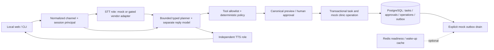

# Saathi reference architecture — Phase0/1

[PRD](../PRD.md) Section14 is the current scope. [ADR0004](decisions/0004-saathi-foundation-and-channel-gates.md) records the transition; [previous deployed architecture](legacy-home-agents-architecture.md) remains historical implementation evidence.

## Boundaries and persistence

`saathi/` is additive and imports no legacy hosted request handlers. FastAPI validates requests; server-held session credentials identify mock users. Conversations/messages/tasks persist in SQLAlchemy-managed relational tables. Alembic owns schema versions. PostgreSQL is the compose/CI target. SQLite is a documented local deterministic mode while Docker's Linux daemon is unavailable on the development machine. Redis is not the source of operation correctness; this phase has no unattended reminder transport or live scheduler.

A task pins reasoning/conversation/STT/TTS profiles. New tasks pick up operator configuration; resumed tasks retain saved profiles. Deterministic mock planners return typed goals/steps and mocked slot IDs. Model output never supplies approval or permissions. Server policy validates manifests, inputs, actor ownership, preview hash/version/expiry and one-time approval. The mock provider operation, receipt, task transition and outbox intent commit atomically. Ambiguous operations enter RECONCILIATION_REQUIRED and can only reconcile by their server-created operation key. External provider operations are not implemented by this atomic mock transaction.

## Scope and security

Local mock browser identities are scoped, not verified real-world/family identities. Web UI uses same-origin session cookies and CSRF controls; CLI uses a separate normalized channel with a locally provisioned mock principal. Credentials and raw audio are not model/tool context or logs. Audio fixtures are synthetic test data; no native-speaker accuracy claim. Production WhatsApp and all real action adapters remain disabled. See [vendor gates](compliance-and-vendor-gates.md).

## Verification sources

Implementation acceptance lives in [Phase0/1 plan](../tasks/saathi-phase01.md). Test commands, demo commands and actual executed versus blocked evidence will be recorded in the Phase0/1 implementation report. Current Cloud Run Home Agents release is preserved; no existing snapshots are migrated or exposed to the new service.
