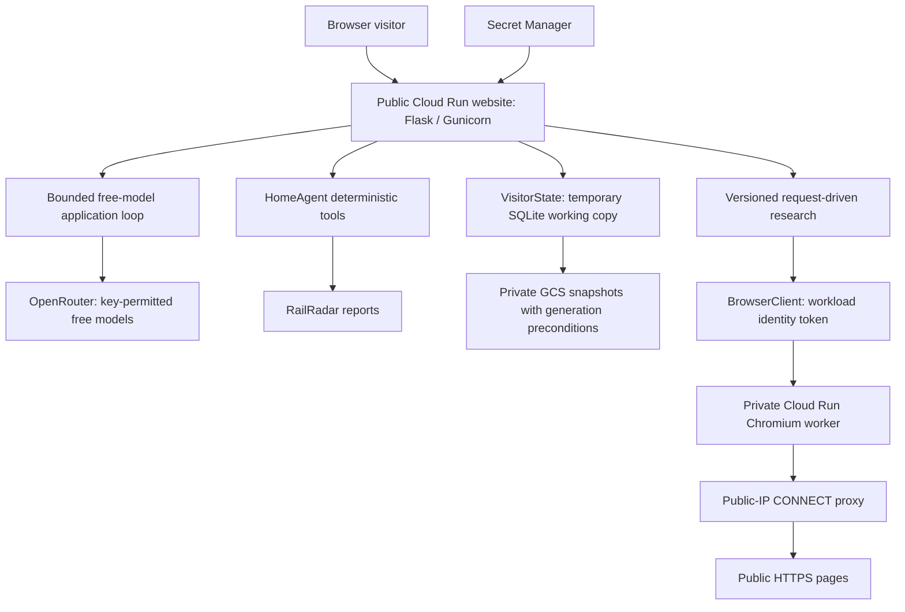
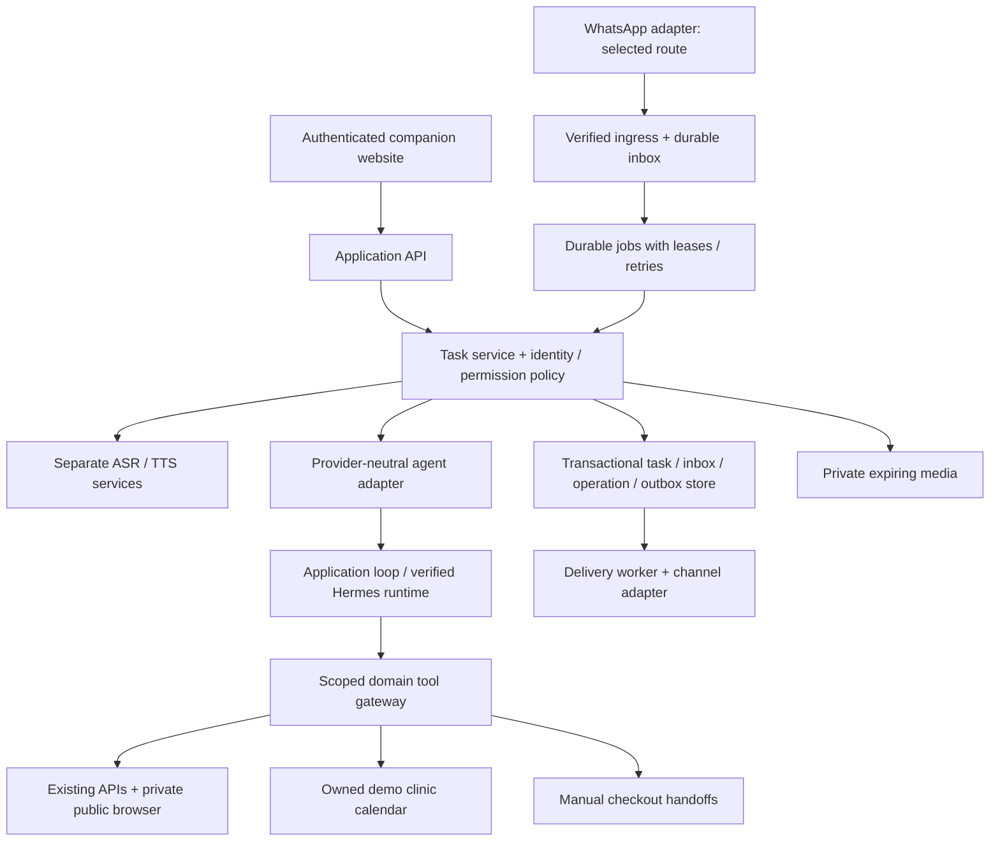

# Architecture: deployed system and target design

Baseline: 26 October 2026. **Sections 1–3 describe implemented behavior. Section4 is proposed evolution.** Source paths are relative to the repository root.

## 1. Deployed topology



The website and browser are separate trust domains. The website has model/railway credentials and visitor storage access. The worker receives only a public URL and declarative read actions, has no mounted provider keys or project-data roles, and is invokable by the website's service identity. The public frontend does not receive those credentials.

| Component | Responsibility | Important contract |
| --- | --- | --- |
| `web/` | Conversation, kitchen, Activity, connections, explicit human controls | Render untrusted strings as text; same-origin JSON requests |
| `hosted.py` | Public HTTP, cookie boundary, validation, budgets, integration status | Initialize visitor before mutations; persist before returning success |
| `service.py` / `contracts.py` | Validated deterministic tools and owner/cook policy | Model can propose, application validates; approval/stock commits stay outside model tools |
| `agent_loop.py` | At most 3 model requests and 2 tool calls per ordinary message | Observe actual tool results; queued browser research has its own later step loop |
| `model_catalog.py` | Authenticated discovery/cache of permitted zero-price tool-capable models | Catalogue success is not a capacity guarantee; fail closed on unverified discovery |
| `cloud_state.py` / `store.py` | Visitor isolation, SQLite transactions, GCS optimistic saves | No external exactly-once guarantee; snapshot persistence is a demo tradeoff |
| `research.py` | Start/step/resume task, source observations, quote validation | At most 6 steps; version mismatch returns current task; no background scheduler |
| `browser_client.py` | Private IAM-authenticated worker invocation and observation validation | Fixed Cloud Run endpoint; only URL/actions sent, bounded response |
| `browser_worker.py` / `browser_policy.py` / `browser_proxy.py` | Fresh Chromium context, declarative actions, egress and account/action guards | Public HTTPS; DNS checked and actual connection pinned to validated public IP |
| `trains.py` | Identity/date/freshness validation, cache and provider errors | Never silently replace a failed real provider with fixture data |

## 2. Request and persistence behavior

```mermaid
sequenceDiagram
    participant U as Visitor
    participant W as Hosted API
    participant S as VisitorState
    participant T as Tool / Browser / Model
    participant G as Private GCS
    U->>W: GET /api/state
    W->>S: Resolve or create anonymous workspace
    S->>G: Load snapshot generation, or create fresh state
    W-->>U: State + secure visitor cookie
    U->>W: POST with Origin, cookie and X-Home-Agent header
    W->>S: Load isolated snapshot at generation N
    S->>T: Execute allowed read or local demo change
    T-->>S: Actual observation / normalized failure
    S->>G: Save with generation-match N
    alt Save accepted
        W-->>U: Persisted task/result
    else Concurrent generation conflict
        W-->>U: 409 CONFLICT; refresh state
    end
```

The anonymous cookie is a bearer credential for one demo workspace. Its seven-day cookie lifetime is not a server-data deletion policy. Creating a new conversation changes the message session, not the visitor's kitchen/task ownership. Hosted users cannot choose their own actor to become a different account; local MCP uses a separately configured fixed role.

Model requests and browser reads happen during HTTP requests. The application uses one Gunicorn process with threads; in-process budgets and striped locks are not a distributed queue or global billing enforcement. Remote reads can complete before a later snapshot conflict; retrying read-only work is acceptable, whereas retrying a real charge this way would be unsafe.

## 3. Browser execution and evidence

The initial URL can be inspected without any LLM call. Agent-mode research subsequently asks a permitted model for one structured browser action, a supported-source answer or a handoff. Browser requests start fresh; the model must include the complete relevant form-action chain rather than assume a retained login/session. The website client continues while the task is running and the page is visible. Hiding/closing the client stops further steps after the current request; persisted history supports manual resume.

Policy checks block private/reserved destinations, non-HTTPS URLs, credential-bearing/account/payment paths, password/account fields, dangerous action labels, non-GET/HEAD requests, downloads, service workers and WebSockets. These are bounded application controls, not proof that every public website's GET has no side effect. Do not expand this profile into authenticated accounts by adding cookies.

Page text, controls and links are untrusted evidence. Completion requires an exact quote from an observed, non-error page. This ties an answer to a source, but does not independently validate every model claim or establish live flight status. Source date/freshness and task-specific correctness still matter.

## 4. Target architecture: proposed, not deployed



### Boundaries to introduce incrementally

1. **Provider-neutral planning:** normalized tool/message/usage/error contracts around existing adapters. Preserve `HomeAgent` rather than rewriting tools or requiring a new framework. Runtime/provider choice is separate from whether tools may execute.
2. **Identity and channel ownership:** persistent principals, memberships and verified sender binding. Private bills/appointments must not inherit shared-kitchen visibility. Anonymous historical state needs an explicit claim/migration flow.
3. **Durable inbox/jobs/outbox:** receipt deduplication, task versions, leases, retry budgets and delivery reconciliation. Select the GCP job-delivery mechanism through an ADR; at-least-once delivery still needs idempotent handlers.
4. **Transactional store:** evaluate PostgreSQL for multi-user owned booking and operation constraints. No Cloud SQL instance is provisioned by this proposal; validate cost/quotas and choose placement before deployment. Preserve existing snapshots during migration until restore/rollback evidence exists.
5. **Speech services:** independently version ASR/TTS, benchmark open-weight candidates and expose a narrow contract. No always-on GPU is assumed. Media references are private and expiration-controlled.
6. **Verified Hermes runtime:** connect the restricted plugin/toolset in a supported source environment. Do not colocate unrestricted terminal/browser tools with production provider keys. Keep user task identity outside runtime-specific conversation caches.
7. **Transactional integrations later:** provider-supported login/access, payload-bound approval, operation ledger and reconciliation. Do not reuse anonymous GCS snapshots as a financial executor.

### Deployment choices to retain or revisit

Retain Cloud Run for the current stateless HTTP website and isolated browser worker. An official webhook-based WhatsApp route can be evaluated with HTTP ingress; a persistent bridge may require a continuously running placement and a different identity/session lifecycle. Do not infer that a scaled-to-zero request service is an always-connected bridge. Record the route decision before provisioning a VM or weakening channel restrictions.

Keep model interchangeability and domain tools as interfaces; avoid adding microservices merely to represent three product agents. Separate speech/browser processes because their resource and trust profiles differ, not because every domain needs a server.

See [data/task design](data-and-task-design.md), [voice/channel plan](voice-and-whatsapp-plan.md), [security](security-and-privacy.md) and accepted [ADRs](README.md).
