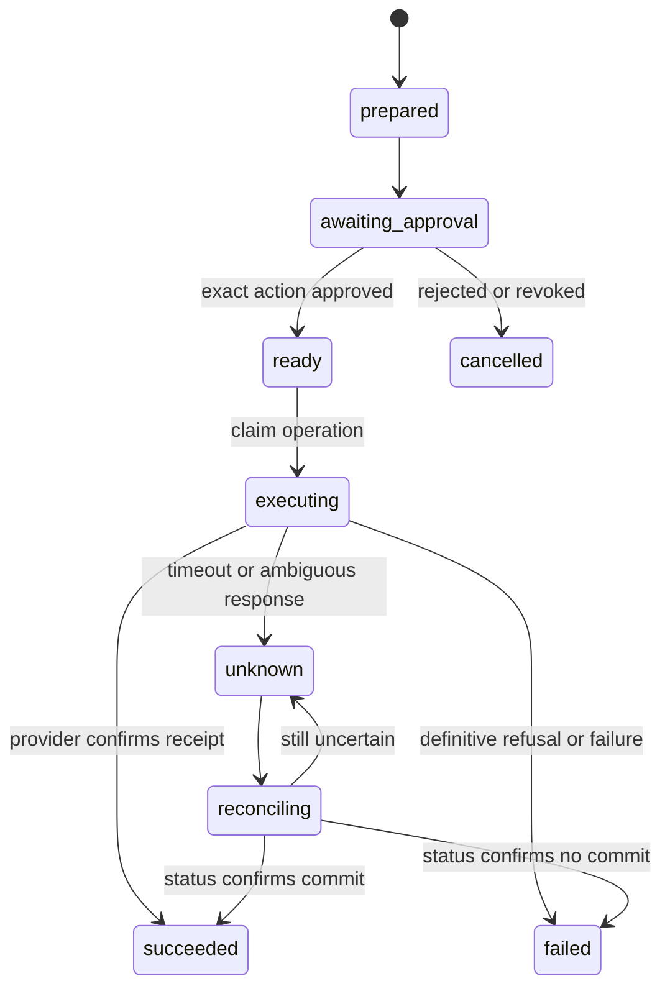

# Data, task state and migration design

The current schema below is implemented in `home_agent/store.py`. Target entities and state transitions later in this document are proposals. Do not add a payment executor to the current snapshot boundary.

## Current storage model

One anonymous visitor owns one SQLite snapshot. `VisitorState` hashes the validated browser token into `visitors/<sha256>.sqlite3` in private GCS; a temporary local working copy is loaded per request. A generation precondition protects download/upload against concurrent stale snapshots. Local hosted development uses atomically replaced files instead. SQLite operations use short `BEGIN IMMEDIATE` transactions.

| Table | Key fields | Meaning / uniqueness |
| --- | --- | --- |
| `settings` | `key`, `value` | Seeding marker and local settings; `key` primary key |
| `tasks` | `id`, `kind`, `actor`, `session`, `status`, JSON `args`/`result`, timestamps | `id` primary key; args/result schemas depend on kind; not a general versioned operations ledger |
| `messages` | `id`, `session`, `request_id`, `fingerprint`, `language`, input, JSON response, timestamp | Unique `(session, request_id)`; changed content for same request conflicts |
| `inventory` | `name`, `quantity`, `unit` | Current balance per normalized name; quantity is an estimate, not a physical sensor reading |
| `inventory_events` | `id`, name/delta/unit/source/estimated/time | Event ID primary key prevents repeated stock events; append-only history |
| `receipts` | `id`, `fingerprint`, JSON `result` | Same reference/content returns previous import; changed content conflicts |
| `stock_corrections` | `id`, name/quantity/unit, JSON `result` | Repeat-safe user correction reference; stock history retains the adjustment |

There are currently no household-membership, user-login, booking, approval-challenge, media, job, operation or outbox tables. Table-column types and validation in the source are the implementation authority; this table is an explanatory map, not migration DDL.

Snapshot limits include5 MB per workspace, 100 messages through the hosted messages route, bounded history returned in snapshots and 20 research tasks per workspace. The UI's history limit does not mean older records were deleted. No verified automatic state-retention/deletion policy exists.

## Current task state rules

| Kind | Normal entry | Allowed progression | Important exclusion |
| --- | --- | --- | --- |
| Train/inventory/suggestions | `succeeded` or provider/validation error | Saved result with source/mode | `succeeded` train result can still be `stale`/`reported`; inspect freshness |
| Offline incomplete request | `needs_input` | Clarify within conversation and validate | Limited phrase router, not generic task reasoning |
| Sandbox bill/journey | `awaiting_approval` | Owner UI approval→`succeeded`; cancellation→`cancelled` | Only these kinds can use current `approve()`; receipt starts `SANDBOX-` |
| Recipe plan | `planned` | Human meal completion→`succeeded`, stock deducted once; or cancel | Planning/suggestion never consumes stock |
| Checkout handoff | `needs_input` | Manual provider handoff or discard→`cancelled` | Cannot use approval-to-execute, never creates an application receipt |
| Web research | `planned` | `running` / `needs_input` / `succeeded` / `failed` / `cancelled` | No external transactional commit |

Research stores `args.version` separately from the task table. Start persists a request fingerprint over goal/URL/mode/model/session; same start request ID/content returns the original task. A step with an old expected version returns current state. Terminal research tasks do not execute again. Each saved advance consumes a version, including recoverable failures; retrying busy providers eventually reaches the six-step budget. Model switching must use the current version and a key-permitted free model.

Local sandbox approvals and meal completion are transactionally repeat-safe inside the working database. GCS generation conflicts can reject the surrounding save; this pattern must not be claimed as exactly-once external execution.

## Proposed durable entities

Design migrations around explicit ownership and invariants, not serialized whole-workspace JSON alone.

| Entity | Minimum fields / invariant |
| --- | --- |
| `principals`, `households`, `memberships` | Verified principal, household, role, revocation; authorization from stored membership |
| `channel_bindings` | Provider/channel, verified sender identifier, principal, verification/revocation times; no principal supplied by model |
| `conversations`, `inbound_messages` | Channel conversation, sender scope, provider message ID, receipt time, content/media reference; unique provider event/message dedup key |
| `tasks`, `task_observations` | Principal/household scope, kind, status, version, canonical arguments, source timestamps, normalized error/evidence |
| `media_objects` | Owner, object reference, MIME, size, duration, checksum, expires/deleted times, consent/retention policy version |
| `approvals` | Task/version, actor, action payload hash, expiry, nonce/challenge, consumed/revoked state |
| `operations` | Operation ID, task/version, provider, idempotency key, payload hash, state, receipt/status reference, retry/reconcile times |
| `clinics`, `services`, `slots`, `bookings` | Demo labels, timezone, slot/service/version, principal, active status; one active booking per slot enforced by DB |
| `jobs` | Type/task/version, due time, lease owner/expiry, attempts/max attempts, last error, terminal state |
| `outbound_messages` / `reminders` | Conversation/recipient scope, task/booking version, delivery idempotency key, status/provider reference, due time |
| Inventory ledger | Household scope, normalized item/unit, purchase/meal/correction references, estimated/source metadata, reversal link |

This is a logical design. Choose actual database types, indexes, key retention, encryption and migration tooling in the implementation ADR. Money, if later needed, uses integer minor units plus currency, never binary floats. Existing inventory quantities use REAL and are not suitable money types.

## Proposed operation state machine

These proposed operation states must not be confused with today's research statuses. `unknown` is not a license to retry a payment/order. Query provider status using the original operation/idempotency reference first. A real cancellation after a successful action is a separate authorized operation with its own verified result.

Approval must bind the exact provider, item/service, recipient/account, relevant address/date/time, final total/currency, task version and expiry. Changed details invalidate approval. A model-supplied `approved=true`, an old “yes,” or consent for another task grants nothing. Human UI/channel confirmation must be bound by application policy.

For the owned no-charge clinic calendar, operation success and booking creation can be one database transaction. Two competing users must produce one booking and one refreshed alternative flow. A reminder job/outbox record references the committed booking version; reminder retry never recreates the booking.

## Migration and recovery sequence

1. Add schema versioning and a reversible staging migration with synthetic fixtures; do not mutate production snapshots in place during design.
2. Establish verified identity and an explicit workspace-claim flow. Never map arbitrary supplied visitor IDs to another user's data.
3. Define conversion of units, timestamps, JSON task variants, provenance and duplicate references. Validate row counts, balances and ownership after conversion.
4. Back up/export existing state with restricted access; rehearse restoration into a separate environment. Document GCS versioning/soft-delete behavior actually configured, not assumed.
5. Import one test workspace and compare task/history/inventory outputs. Make one store authoritative for writes; avoid uncontrolled dual-write divergence.
6. Cut over a controlled cohort behind a flag. Read-only fallback/rollback must not undo newer authoritative operations. Keep snapshots until retention/rollback decisions are explicit.
7. Enable owned-calendar atomic booking only after duplicate, concurrency, crash/restart and authorization cases pass. Keep external money/orders disabled until their independent ledger/reconciliation gates pass.

See backlog `FOUND-01`, `IDENT-01`, `JOBS-01`, `CLINIC-01` and `TXN-01` for implementation slices.
