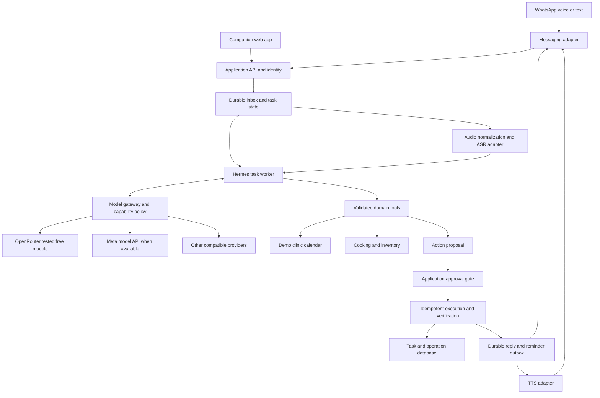

# Home Agents: WhatsApp voice product and architecture

Date: 26 October 2026, Asia/Kolkata. Status: revised design; implementation pending.

This is the current design direction. It supersedes the workflow ordering and fixed-model assumptions in `hackathon-demo-spec.md`; `implementation-status.md` remains the evidence for what actually runs today.

Delivery update: the user subsequently prioritized an executable public website before WhatsApp. The immediate Cloud Run deployment is documented in `hosted-deployment.md` and ADR-002; the VM and clinic-first sequence below remain broader design proposals, not the website's current topology or shipped feature list.

## Inputs and scope

The user requires interchangeable models, a primarily WhatsApp voice experience, GCP as an available hosting platform, and Tamil, Malayalam, Kannada, Hindi, and English. Everyday tasks remain first priority; cooking and inventory remain part of the product. The user has selected a demo clinic calendar that we control.

`Project_Saathi_Hackathon_Idea.docx` is reference material. Its appointment-booking story is adopted as the hero workflow. Its proposed Muse-only reasoning, Modal hosting, narrower language list, and public-repository/submission suggestions are not binding instructions. Home Agents remains the product name. No publication, external appointment, account pairing, or cloud spending follows merely from those suggestions.

Product promise: send a voice note, resolve missing details in conversation, approve a specific action, and receive a verified result in the same language. Users should be able to complete the main workflow entirely within WhatsApp. The web application becomes a companion for onboarding, task history, household inventory, and debugging.

## Product changes

| Area | Revised direction | Reason |
| --- | --- | --- |
| Main demo | Voice-led appointment booking against our demo clinic calendar | A complete action with choices, approval, recovery, and reminder |
| Interface | WhatsApp voice first; concise text receipts and voice replies | Matches actual intended use |
| Models | Separate replaceable reasoning, ASR, TTS, and vision providers | Changing an LLM must not require rebuilding speech or tools |
| Agent structure | One shared runtime, three domain toolsets | Shared identity, task records, memory, and inventory |
| Hosting | GCP application host plus separate speech service | Uses available resources without coupling the app to a GPU |
| Reliability | Durable tasks, approvals, execution records, and outbound messages | A restart or model switch must not repeat an action |
| Personal data | Personal tasks private; kitchen information shared by explicit membership | A cook should not see personal appointments or bills |

## First complete journey

1. User sends a Tamil, Malayalam, Kannada, or Hindi voice note: “Book my dental cleaning Saturday morning.” English and mixed-language requests are also supported targets.
2. Authenticate the sender, deduplicate the message, save the task, and acknowledge receipt promptly. Transcribe the audio and preserve its original language text.
3. Resolve location and exact date. Read back critical fields when uncertain. “Saturday” becomes a displayed/spoken calendar date in Asia/Kolkata; an ambiguous word such as “kal” triggers clarification.
4. Query the demo clinic calendar. Offer at most three available slots, with short numbered choices and a spoken summary. Every option is explicitly a demo clinic appointment.
5. User chooses a slot. Present the clinic, service, date, time, timezone, and any fee in one approval request. State “no charge” for the initial calendar. Selection is not yet authorization to book.
6. User approves by a reply tied to that request. Recheck the slot and create the booking atomically. If it has gone, offer new slots and request fresh approval.
7. Return the stored booking reference, exact details, and a short spoken confirmation. Schedule a durable reminder only after successful booking.
8. Handle “change the time,” “cancel,” a duplicate message, or a provider timeout without inventing a successful result. Never send a success claim solely because the model generated one.

The demo calendar has seeded clinic/service/slot records and persistent bookings. It is not an external clinic integration. A short, explicitly requested test reminder can demonstrate delivery; ordinary appointment reminders use a configured lead time and the chosen channel's messaging rules. A reminder-delivery failure does not erase a successful booking.

Healthcare scope is administrative scheduling. Diagnosis, triage, and treatment recommendations are outside this workflow.

## Architecture

The diagram shows logical boundaries. The first version does not need one microservice per box. API, task worker, scheduler, and database can share one GCP VM, with separate processes and private interfaces. Speech is independently deployable because its dependencies and hardware requirements differ.

### Model interchangeability

The gateway owns provider configuration and translates provider-specific request/response formats. The application owns normalized conversation records, validated tool observations, task state, and action proposals. Provider-specific hidden reasoning is never required to resume a task.

| Role | Contract | Selection policy |
| --- | --- | --- |
| Reasoning | Messages + allowed tool schemas -> text or validated tool calls | Tool support, Hermes compatibility, context size, locale evaluation, cost |
| ASR | Authorized audio + language hint -> transcript + detected locale + optional timestamps/uncertainty | Four-language accuracy, mixed-language entities, latency, license/access |
| TTS | Localized text + locale + approved voice -> audio | Pronunciation of dates/names, four-language coverage, latency |
| Vision, later | Authorized bill image -> structured extraction with evidence | Schema correctness and human review before inventory mutation |

Each configured reasoning model has a provider ID, model ID, credential reference, capability metadata, context limit, timeout, output limits, cost policy, and evaluated locales. Configuration contains references to secrets, never secret values committed to Git. A model may handle conversation without qualifying to execute the tool workflow.

Start with an evaluated, pinned OpenRouter free model and a small explicit free-only fallback list. Avoid random model selection during the recorded demo. Require tool-capable routes, validate all returned arguments, and reject unsupported schemas. Normalized errors include `rate_limited`, `unavailable`, `invalid_output`, and `unsupported_capability`. A compatible API URL alone does not establish equivalent behavior.

Keep the selected model fixed within a running attempt. On failure, stop at a persisted checkpoint; a new attempt may use another approved model and the same observed state. Never retry a booking because a new model asks to call it again. Operation records and idempotency keys govern execution independently of model identity.

Meta remains a first-class adapter for meaningful hackathon use once access is available. Do not assume a checkpoint called “Muse Spark Open” is downloadable or deployable from the brief alone. Validate the exact available model, terms, capabilities, and hackathon requirements before committing it to the submission story.

OpenRouter free inference is quota-limited, and one user journey can consume multiple model requests. Use account-wide admission limits, bounded agent iterations, exponential backoff for safe reads, and a clear busy/retry reply. Paid fallback is disabled by default. GCP credits do not automatically fund OpenRouter calls. [OpenRouter limits](https://openrouter.ai/docs/api_reference/limits), [provider capability routing](https://openrouter.ai/docs/guides/routing/provider-selection).

### Hermes boundary

Embed a pinned, tested Hermes revision behind the worker interface. Create an isolated agent instance per task execution; restore only that sender's permitted context. Disable unrelated local files, global memories, terminal, and broad browser tools in the booking profile. Expose only the selected domain's validated tools. Start with a maximum of eight model iterations per turn, plus wall-time and request-budget limits; measure and tune this ceiling.

Hermes performs the model/tool/observation loop. Application code governs identities, approvals, durable state, retries, reminders, and transaction outcomes. Model-generated `approved: true` is never trusted. Persist observations and user-visible results, rather than chain-of-thought.

Hermes documents programmatic agent use and warns against concurrent sharing of a single agent instance. Pin the supported installation method and dependencies for the selected revision rather than assuming an unrelated package with a similar name is correct. [Hermes Python integration](https://hermes-agent.nousresearch.com/docs/guides/python-library).

### Speech and conversation

Download media only through the selected channel's authenticated media mechanism; accept bounded size/duration and decode in a constrained process. Normalize WhatsApp audio to the ASR service's required format. Preserve native-script transcripts; do not force an English translation before reasoning. Use a stored language preference with explicit user overrides, and evaluate code switching separately from monolingual coverage.

Benchmark AI4Bharat ASR/TTS checkpoints behind these interfaces. IndicConformer and IndicF5 model cards list all four requested Indian languages and currently point to newer Indic-Transcribe and Indic-Speak alternatives. Check model access, exact license, runtime needs, and recorded speech before selecting versions. Language coverage alone is not proof of task accuracy. Use an approved stock/reference voice; English speech may require a separate checkpoint. [ASR model card](https://huggingface.co/ai4bharat/indic-conformer-600m-multilingual), [TTS model card](https://huggingface.co/ai4bharat/IndicF5).

Read back clinic, date, time, and amount before approval, especially if transcription is uncertain. Do not invent numerical confidence scores when the ASR model does not supply them. If synthesis fails, deliver the truthful text result and offer an audio retry; do not rerun the action. Keep replies short and retain text references for later inspection.

### Identity, approval, and privacy

Map a verified channel sender to a member and household server-side. Never accept a household ID or role supplied by the model as authorization. Appointment and bill tasks are private to the initiating member by default; kitchen access can be shared with a cook role. Invitations explicitly establish household membership.

Approvals bind the member, task ID, task version, exact action payload hash, and expiry. A button/token is single-use. A spoken “yes” can apply only to one unexpired, explicitly presented pending request in that conversation; otherwise ask which action. Repeated approvals return the existing result. Changing details invalidates old approvals. Public companion pages require actual authentication; the present localhost owner console is not suitable for exposure as-is.

Raw recordings and transcripts are private data. Proposed demo retention: delete raw audio after 24 hours and completed conversational transcripts after seven days unless the user explicitly retains them; preserve only necessary task receipts and revocable preferences. A deletion process covers database rows, media, and eventual backup expiry. Logs use opaque IDs and omit voice, transcript bodies, credentials, and appointment details. Confirm actual provider data policies before sending personal content to free inference routes.

### Messaging feasibility

WhatsApp is the target interface; its eligibility is an early dependency, not an assumed solved integration. The indexed official Business Solution Terms restrict AI providers offering general-purpose assistants as the primary service, with specified country-code exceptions. An India-focused personal assistant needs eligibility confirmation from Meta or the chosen BSP. A clinic's own narrowly scoped booking service may be a different use case, but this is not an assumed exemption. The English terms page redirected to login during review; verify the applicable current terms with the provider before production use. [Official terms indexed during review](https://www.whatsapp.com/legal/business-solution-terms?lang=pa&locale=ca_ES).

Hermes also documents an unofficial WhatsApp Web/Baileys bridge. Treat that as an optional dedicated-number prototype route with account and protocol risks, not a production guarantee or a workaround for platform eligibility. Do not pair an account automatically. Channel policy, credentials, sender verification, outbound windows/templates, voice output formats, and any group support must be checked for the chosen route. Start with direct messages; defer cook-group delivery until explicitly supported. [Hermes WhatsApp integration](https://hermes-agent.nousresearch.com/docs/user-guide/messaging/whatsapp).

Keep a labeled web voice transport for development and failure diagnosis. It exercises the same backend but does not count as a live WhatsApp demonstration.

## GCP deployment proposal

| Component | Initial placement | Rationale |
| --- | --- | --- |
| API + Hermes worker + scheduler | One modest Compute Engine VM; separate supervised containers/processes | Suits an always-connected bridge and durable background work |
| Task/calendar database | SQLite on persistent disk, single application host, transactional migrations | Reuses current skills/code and avoids an always-on managed DB for the hackathon |
| Database backup | Consistent SQLite backup to a private Cloud Storage bucket; restore rehearsal | A VM disk alone is not a recovery plan |
| Voice/media | Private Cloud Storage with lifecycle deletion | Keeps audio separate from compute and out of public static hosting |
| Secrets | Secret Manager and narrowly scoped service identity | No credentials in browser code or repository |
| Speech inference | Separate service; benchmark CPU first, limited GPU service if needed and available | Hardware follows measured speed and memory requirements |
| Deployment images | Artifact Registry | Reproducible pinned runtime |
| Logs/metrics | Cloud Logging with retention limits | Observe failures, latency, usage, and delivery without exposing content |

Use an HTTPS reverse proxy/ingress, a production ASGI API adapter, restricted firewall rules, private database access, and verified webhook signatures. Replace the localhost-only standard-library HTTP server at the public boundary; keep reusable domain logic. The companion app can be served by this host or a static host with an authenticated API connection.

The user has selected project `sathi-home-agent` and region `us-central1`. Read-only CLI checks confirmed the project is active and billing is enabled; remaining credit balance, expiry, GPU quotas, VM sizing, and current costs are unverified. See `gcp-setup.md` for the exact target and API readiness. Start with one application host, no always-on GPU, and no Kubernetes requirement. A planning allocation of the reported INR 15,000 is INR 3,000 for app/storage/networking, INR 6,000 for capped speech experiments, and INR 6,000 reserve. These are allocation ceilings, not price estimates or a billing guarantee. Check credit eligibility/expiry, current regional rates, and available spend controls before provisioning. Avoid accumulating recordings and unbounded logs.

Cloud Run is a good later choice for stateless HTTP ingress or separately deployed speech, subject to runtime and quota checks. The default writable container filesystem is not durable; do not put the task SQLite database there. A scaled-to-zero HTTP service is not a substitute for the always-connected bridge deployment. [Cloud Run runtime contract](https://docs.cloud.google.com/run/docs/container-contract).

Initially, persist jobs and a reply/reminder outbox in the application database; claim jobs with leases and bounded retries so a crash can resume them. Cloud Tasks is optional for later authenticated HTTP job delivery. Its delivery is at least once, so handlers still require idempotency. Neither option guarantees a human receives a reminder at an exact instant. [Cloud Tasks behavior](https://docs.cloud.google.com/tasks/docs/dual-overview).

Move to PostgreSQL before running multiple application hosts or requiring sustained concurrent writes. This is a deliberate single-host demo tradeoff: VM maintenance, restore, and availability remain our responsibility.

## State and integration contracts

Canonical task states: `received -> transcribing (audio only) -> planning -> needs_input / awaiting_approval -> executing -> succeeded / failed / unknown`. A follow-up resumes planning; cancellation is allowed before commit. After commit, cancellation is a separate verified operation. Reminder state is separate from booking success. An `unknown` external operation must be reconciled before a new execution attempt.

| Boundary | Required input | Output / invariant |
| --- | --- | --- |
| Channel ingress | Provider message ID, authenticated sender, conversation ID, timestamp, text or authorized media reference | Canonical message ID; duplicate provider events do not start a second task |
| Agent turn | Task ID/version, normalized messages, scoped observations, model profile, allowed schemas | Reply, clarification, tool request, or action proposal; never direct authorization |
| Tool call | Validated arguments plus application-injected member/task context | Structured data or normalized error with source and observation time |
| Approval | Single-use challenge bound to sender, task version, payload hash, expiry | Persisted approval; stale or mismatched details rejected |
| Action execution | Verified approval, operation ID, idempotency key | Verified receipt, failure, or unknown status; repeat returns same operation |
| Reminder delivery | Booking ID/version, due time, unique delivery key | Outbox status and provider delivery reference; retries do not create new bookings |

Internal contracts should be versioned and validated at untrusted boundaries. New public HTTP routes need explicit typed schemas and authentication before implementation; existing localhost endpoints are not implicitly made public by this design.

Minimum new persistent records: members, households, memberships, conversations, inbound messages, tasks with versions, task observations, approvals, operations, clinic/service/slot records, bookings, jobs, reminders, outbound messages, and revocable preferences. Use foreign keys and ownership checks. Enforce a unique active booking per clinic slot and unique idempotency keys. For the owned demo calendar, booking creation and operation success can be committed in the same database transaction. External providers later require status reconciliation across network failures.

Booking tool surface: `search_clinics`, `search_slots`, `prepare_booking`, `get_booking_status`, and application-gated `create_booking` / `cancel_booking`. Scheduling a reminder uses a verified booking. No payment tool is needed for the initial no-charge clinic. Calendar event export is optional; it must not create a second independent booking authority.

## Cooking and inventory remain connected

Agent 1 accepts recipe evidence plus a voice customization, checks inventory, and gives short instructions in the chosen language. Ingredient quantities retain source/estimate provenance. If video content or captions cannot be retrieved, ask for accessible source material and disclose what was processed rather than claiming to have watched it.

Agent 2 stages grocery-list/bill extraction for review before adding stock. Consumption is an estimate recorded after meal completion, not after recipe suggestion. Corrections append events and can undo mistaken estimates. Receipts, duplicate imports, cooking plans, and consumption share the household inventory ledger. Never let a model silently infer exact remaining stock from an uncertain meal description.

The three “agents” are domain profiles over shared tools and state. Multi-agent delegation adds complexity without helping this first workflow and is not required.

## Existing implementation and migration

Reuse the deterministic domain tools, validation, inventory event approach, replay protection, MCP tool schemas, and offline regression tests. Extend persistence with ownership and durable approvals before exposing real users. The existing Muse adapter makes one model/tool selection; it is not yet a full Hermes observation/recovery loop. Speech interfaces exist, but actual ASR/TTS and WhatsApp are not connected.

Build the demo calendar and durable action boundary first, then model switching and Hermes, then the voice round trip and messaging adapter. Keep the current local and public Sites demos available as explicitly offline demonstrations. The published Site uses browser-local state and does not acquire Python, shared state, live models, or voice integration merely because this design exists.

Acceptance tests and the ordered work are in `../tasks/voice-first-plan.md`. The deployment/model decision is recorded in `decisions/0001-whatsapp-voice-model-independent-gcp.md`.
