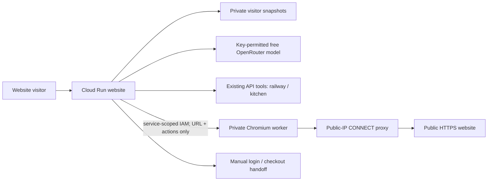

# Hybrid browser implementation and operations

Implemented 26 October 2026, Asia/Kolkata. [Product spec](hybrid-agent-spec.md), [delivery plan](../tasks/hybrid-agent-plan.md).

## What is available

On the [public website](https://home-agents-xswei7prnq-uc.a.run.app/), open **Activity → Public web research**. Choose direct page inspection to read a public HTTPS URL without LLM inference or a domain API key. Choose AI research to use the permitted free model selected in Connections. An assistant conversation can also queue research through `start_web_research` when live model inference is available.

Page sources, observation times, text, trace and task version are saved per visitor. Continue research can select another permitted free model without changing task identity. The client advances one persisted step at a time; closing/hiding the page stops further client-driven steps after the current request. Resume from Activity. This is not a durable background scheduler.

Activity also has **Bills & food orders → Prepare a handoff**. This saves an unverified draft and provider link with a review checklist. The provider's secure flow completes the actual transaction manually. The draft cannot be approved to execute and has no receipt. Existing sandbox bill/journey examples remain clearly labeled simulations.

## Architecture

The website retains provider credentials; browser requests do not carry household state, unrelated conversation, or provider keys. Each worker call starts a fresh Chromium context with no persistent logins or downloads. Browser actions are bounded declarative fill/click/select objects, not model-written code. Controls block account/credential/payment fields and transaction buttons; routes allow GET/HEAD HTTPS only, block WebSockets and service workers, and cap network requests. A CONNECT proxy validates all DNS results and pins the actual TCP connection to a public numeric IP. Policy guards are application controls, not a guarantee that every public GET has no server-side effect. Authenticated accounts are outside this profile.

Research permits six persisted steps, at most six form actions per browser request, 20 tasks per visitor, and bounded page text/links/controls. The website limits browser calls to six/minute and 100/day per application process; instance restarts reset these process-local budgets. This is not a billing hard cap. One worker instance, one request at a time, zero minimum instances limits resources; active browser/build/storage time can consume GCP credits.

Model answers require an exact quote from an inspected page, linked to its URL/time. Quote validation anchors provenance; it does not prove every generated inference or the source's live-data freshness. A schedule or snippet cannot establish current flight status. Unsupported requests, challenge/login pages, HTTP errors and model outages produce explicit paused/handoff results, retaining existing evidence.

## Cloud resources

- Website revision: `home-agents-00007-r6f`; image build `7f41ad49-a6a6-40d7-a9a4-7c91844f7b8a`.
- Private worker service: `home-agents-browser`, `us-central1`.
- Worker URL: `https://home-agents-browser-59012364414.us-central1.run.app` (IAM required).
- Worker revision: `home-agents-browser-00001-w2m`; image build `0604bf8b-5c08-4f48-84d5-a2b4d8f5f07f`.
- Worker identity: `home-agents-browser@sathi-home-agent.iam.gserviceaccount.com`; no secrets mounted or project-data roles granted.
- Only the website runtime has a service-scoped `roles/run.invoker` binding. The website obtains a short-lived ID token through workload identity; no exported service-account key.
- Worker: Playwright 1.64.1 official Python container, non-root `pwuser`, CPU1, memory1Gi, concurrency1, max instances1, min0, timeout120s. The website keeps its existing two Secret Manager references and state bucket.

For a rebuild, first verify tests, `gcloud meta list-files-for-upload` and a credential scan. Build with `cloudbuild-browser.yaml` using the existing scoped builder and private staging bucket. Deploy the resulting browser image with the dedicated worker identity and `--no-allow-unauthenticated`; do not add public IAM. Preserve the website runtime's worker-scoped invoker binding. Build the website with `cloudbuild.yaml`, then deploy using `deploy/gcp/env.yaml` and **both** existing secret references. Follow [hosted deployment](hosted-deployment.md). Keep `home-agents-00006-x47` as the previous website rollback revision.

## Verification and remaining limits

- Browser dependency audit found no known vulnerabilities. Actual 500px viewport had no horizontal overflow.
- Implementation [GitHub CI passed](https://github.com/anirbanhere/Saathi_Home_Agent/actions/runs/40358466068) for `4644463f9a5648b7a59727a8e877f4a239690069`. Final public health returned `ok`; the ready website revision was verified after rollout.
- 80 unit/API tests passed, including private-URL/DNS checks, pinned proxy connections, unsupported code/actions, ownership, repeated steps, model outage, source quotes, draft non-execution and plugin registration.
- Actual private worker read the Python homepage and filled/submitted its public search form to the results page. Unauthenticated worker access returned 403.
- A fresh public visitor invoked the private worker through the website, saved page evidence, repeated the same step safely, and retrieved persisted history. Actual website form interaction completed and displayed the source. No browser console errors/warnings were present.
- The filtered provider catalog still permits only Gemma 4 26B free. A synthetic research task inspected its source, then paused on the actual provider's HTTP429 while retaining the page. A successful live model→browser→quoted-answer run remains unverified.
- IndiGo's flight-status page returned HTTP403/Access Denied and became `needs_input`; no live flight status was claimed. A supported provider/API or manual website access may still be required for such sites.
- [Hermes plugin bridge](../integrations/hermes-public-browser/README.md) has registration/handler tests; a real Hermes session and integration with hosted task state are not connected. WhatsApp, Indic speech and Meta access remain separate work.
- Real payments/orders require verified user identity, suitable authenticated account access, an exact approved transaction, durable operation records/idempotency and post-action provider reconciliation. The current anonymous snapshot workspace is not the execution ledger for those effects.
