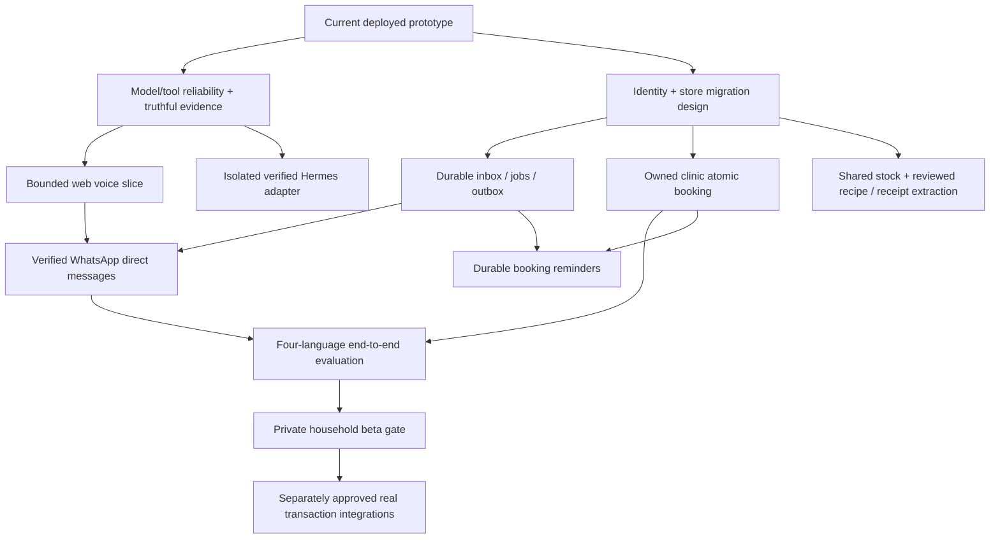

# Development roadmap

Planning baseline: 26 October 2026. Preserve the deployed website and build on verified functionality. Estimates assume one primary engineer with AI assistance and occasional language/product review; they are not measured velocity or delivery commitments. Work on a blocked external credential/capacity gate must not stop independent engineering.

## Priorities and dependency graph

Agent3 everyday tasks leads; cooking/inventory remain useful demo paths and later expand on the shared foundation. A free-model response, a safe tool outcome and source/receipt evidence matter more than the number of agent processes.

## Milestones

| Milestone | Goal | Exit gate | Exclusions / dependency |
| --- | --- | --- | --- |
| M0: verified baseline | Documentation, runnable setup, reproducible existing tests/deployment | Another engineer can run synthetic workflows and distinguish editions/limitations | This documentation delivery; no new product capability implied |
| M1: dependable demo engine | At least one real permitted free-model→tool→observation→grounded reply | Actual trace, bounded failure/retry, preserved task and no fabricated status | Provider capacity may remain an external gate; no paid fallback |
| M2: voice companion | Real web audio→transcript clarification→allowed tool→same-language reply/audio | Measured recordings, critical-field safety and media deletion | Start with a declared tested locale; all four remain release targets |
| M3: durable household foundation | Verified identity plus transactional task/job/operation boundary | Ownership, migration/restore, lease/replay and outbox tests | Database/hosting selection requires cost/architecture decision |
| M4: WhatsApp everyday assistance | One approved direct-message voice journey linked to the same task state | Actual sender verification, ingress/media processing and reply delivery | No group support claim without route evidence |
| M5: owned clinic | Search, selection, scoped approval, atomic booking, status, cancellation/reminder | Concurrent slot contention, crash/restart and duplicate deliveries verified | Clearly labeled demo calendar, no real clinic provider |
| M6: household cooking/inventory | Reviewed source-recipe/receipt extraction, preferences, shared ledger | Provenance, uncertainty, unit normalization, duplicates, consumption and correction | No fake watched-video/physical-stock claims |
| M7: private beta | Four-language/channel quality, deletion/revocation, monitored bounded costs | Gate matrix in evaluation/security/operations docs passes | Financial effects remain separate |
| M8: optional real transactions | One explicitly authorized supported bill/order integration | Strong identity, exact approved payload, durable operation and provider reconciliation/receipt | No activation by completing a backlog checklist alone |

Hermes and Meta adapters are integration tracks across M1–M5, not reasons to rewrite working tools. Keep runtime/provider choices reversible. A successful API adapter can ship before a framework integration if the actual behavior and limits are stated.

## Delivery horizons

**Demo window, October 26–November 4:** stabilize and record current capabilities; attempt the smallest actual free-model/tool journey; add bounded web voice if a tested speech service is feasible. WhatsApp, four-language voice and a new clinic foundation are stretch work, not simultaneous promises. Official event rules are unverified; Meta eligibility needs a separate check.

**Next 2–4 weeks after the demo:** improve model/provider seams and diagnostics, establish identity/media/task foundations, verify the isolated Hermes runtime, and complete one reliable voice flow. Finish external channel preflight without automatically sending messages or provisioning unrelated services.

**Following 4–8 weeks:** transactional store and owned calendar, durable jobs/outbox, selected WhatsApp direct-message integration, four-language evaluation and household/kitchen reuse. Adjust order to actual capacity, licenses, channel eligibility and user feedback.

**Beyond private beta:** controlled persistent account automation and one real provider integration at a time. A general browser agent cannot promise every site permits access or that a draft equals an order.

## Priority and scope rules

1. Keep direct train, kitchen, inspection and manual handoff usable during model outages.
2. Do not weaken authorization, freshness, free-only policy or evidence labels to meet a presentation date.
3. Scope cuts remove breadth: fewer sources/locales claimed, one supported workflow, or text fallback. They never fabricate execution.
4. Implement identity/operation foundations before live external writes; do not hide them inside a browser script.
5. Nous remains skipped; Meta access is deferred. Neither should repeatedly trigger account/key requests.

## Release artifacts

Each milestone needs a Git commit/release identifier, current architecture/API deltas, test/evaluation report, dated real integration evidence, rollback/recovery notes and a concise user-facing capability statement. A live recording identifies fixtures, demo records, unverified interpretations and actual providers. Use [sprint plan](sprint-plan.md) to select capacity and [backlog](backlog.md) for implementation details.
